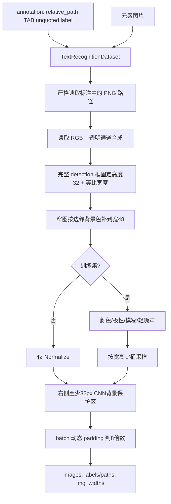
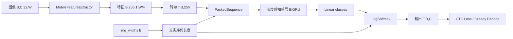
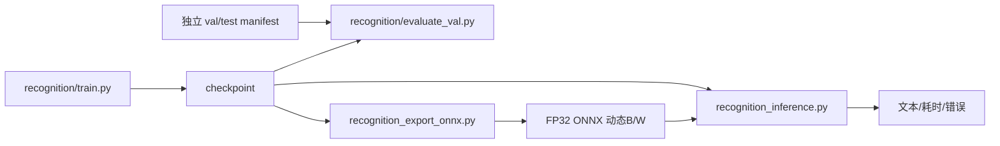

# Recognition 架构

## 1. 职责

Recognition 接收 detection 输出的单个文字框，输出 Unicode 文本。当前它是项目的实际主链路，支持彩色/深浅背景、PNG 和动态宽度处理。

当前基线为 MobileNet 风格 CNN + 单层双向 GRU + CTC head，输入高度固定为 32，宽度按比例缩放并在 batch 内动态 padding。

## 2. 数据与预处理



相关实现：

- `recognition/components/dataset.py`：图片路径校验、PNG 透明通道处理、缩放、增强、桶采样和动态 padding；
- `recognition/utils/checkpoint.py`：checkpoint 解包以及旧灰度/新 RGB 模型通道识别；
- `recognition/components/converter.py`：字典编码和显式 TBC/BTC 的 CTC greedy decode。

训练、验证、PyTorch 推理和多后端推理复用同一套不裁剪基础预处理。训练可额外使用随机增强；验证和测试禁止随机增强。

### 初始训练集/验证集划分

当 `all_images/` 和 `all_annotation.txt` 保存全量数据时，使用
`recognition/split_dataset.py` 做确定性的 80/20 均匀系统抽样。脚本按标注顺序每隔约
5 条抽取一条到验证集，其余进入训练集；总数不能被 5 整除时，会在 4～5 条之间
均匀调整间隔，使验证集数量等于最接近 20% 的整数。

```bash
# 先校验数据并预览数量，不修改文件
.venv/bin/python recognition/split_dataset.py

# 确认后从 all_images 复制图片，并生成 train/val 标注
.venv/bin/python recognition/split_dataset.py --apply
```

脚本不会修改 `all_images/` 和 `all_annotation.txt`。为避免覆盖手工调整，
`train_images/`、`val_images/`、`train_annotation.txt`、`val_annotation.txt` 必须为空；
缺图、重复标注、未标注 PNG 或目标文件冲突也会让脚本在写入前停止。

### 四份标注校对

手工调整 train/val 或隔离字典外字符样本后，运行下列只读脚本校对四份标注：

```bash
.venv/bin/python recognition/utils/check_dataset_annotations.py
```

脚本仅按不含目录的图片文件名判断，例如 `du20260902-002391.png`。它要求
`all = train + val + val_unknown`、三个子集两两没有同名图片，并逐项比较 all 与所属
split 中同名图片后面的识别文字。校对通过返回 0；缺失、多余、跨 split 重复或文字不同
会列出具体文件名并返回 1。每类默认最多显示 20 条详情，传入 `--max-details 0` 可显示全部。

## 3. 模型与张量契约



稳定契约：

- 输入图像：`float32 [B, C, 32, W]`，归一化到以 0.5 为 mean/std 的空间；
- `img_widths`：`int32/int64 [B]`，表示不含右侧背景保护区和 batch padding 的真实图片宽度；
- 输出：`float32 [T, B, num_classes]`，简称 TBC；
- 类别：0=`blank`，1=`UNK`，2 起来自 `keys.txt`；
- `keys.txt` 的内容和顺序是模型 ABI，变更字典必须训练/导出新模型版本；
- CNN 宽度下采样约为 4 倍，CTC 长度必须依据每张图片真实宽度计算。

`LabelConverter.decode` 已要求显式 `layout="TBC"` 或 `"BTC"`。部署入口会用已知 batch size 和类别数把后端输出规范为 TBC，不再用维度大小关系猜测。

每张图片右侧固定增加 32 px 背景保护区，隔离 CNN 感受野与动态 batch 边界；BiGRU 使用 `PackedSequence`，正反向都只处理各图片的有效时间步。自动测试要求同一图片在 batch=1 和混合宽度 batch 中的有效输出一致，并验证 ONNX GRU 带有 `sequence_lens` 输入。

## 4. 训练、评测、导出与推理



主入口：

- `recognition/train.py`：训练与训练期验证；
- `recognition/evaluate_val.py`：独立 manifest 的 Accuracy/CER/错误样本；
- `recognition/inference.py`：PyTorch checkpoint 调试；
- `recognition_export_onnx.py`：带 `img_widths`、动态 batch/width 的 ONNX；
- `recognition_inference.py`：ONNX/OpenVINO/PyTorch 部署推理。

`train.py` 的 `TRAIN_ANNOTATION` 可配置一个标注路径或多个标注路径；当前训练集按配置顺序
合并 `train_annotation.txt` 和 `append_annotation.txt`，各文件内的图片路径分别相对于自身所在目录解析。

示例：

```bash
python recognition/train.py

python recognition/evaluate_val.py \
  --model_path recognition/checkpoints/<model>.pth \
  --annotation recognition/data/val_annotation.txt \
  --batch_size 1

python recognition_export_onnx.py \
  --model_path recognition/checkpoints/<model>.pth \
  --output_path artifacts/recognition/<version>/model.onnx \
  --keys_path recognition/keys.txt \
  --img_height 32 \
  --img_width 256

python recognition_inference.py \
  --model_path artifacts/recognition/<version>/model.onnx \
  --backend auto \
  --keys_path recognition/keys.txt \
  --image_path recognition/data/test_images1 \
  --batch_size 32
```

初次准备数据时，应先从 `all` 使用上述划分脚本建立图片与标注一一对应的独立训练集
和验证集，并运行三份标注校对；划分完成前，不应将训练集评估结果作为发布精度。

## 5. 评测维度

总体 Accuracy/CER 之外，至少按以下网页场景报告：

- `menu-white-text`：菜单、按钮、有色/深色背景白字；
- `small-text-or-sparse`：小文字、大背景、文字占比低；
- `has-icon-or-arrow`：箭头、图标、角标邻接；
- `long-text`：长文本、空格和中英文标点；
- `light-dark-theme`：浅色/深色主题；
- `scale-dpr`：浏览器缩放和不同设备像素比；
- `unknown-char`：字典外字符和规范化策略。

门禁必须包含：跨 split 重复为 0、冲突 label 为 0、batch 一致率 100%、PyTorch/ONNX 文本一致率 100%、关键分组不低于已批准基线。阈值和基线报告都要版本化。

## 6. 已知问题与演进边界

- `train.py` 仍以脚本常量为主，需迁移为可序列化配置与 run manifest。
- 训练数据与标注统一使用 `.png`；路径或扩展名不一致会直接报错，避免自动回退掩盖数据问题或以 dummy tensor 静默污染训练。
- recognition 不再做二次裁剪；detection 框质量需要在 detection 环节单独评估。
- 输入高度目前固定 32；48 高度只能作为同数据、同训练预算的消融实验，不能直接替换现有权重。
- `recognition_quantize_static.py` 当前不进入发布路径。FP32 ONNX/OpenVINO 是默认优化方向。
- `model_resnet50.py` 和历史说明文档属于实验资产，未通过同一门禁前不替代当前基线。
