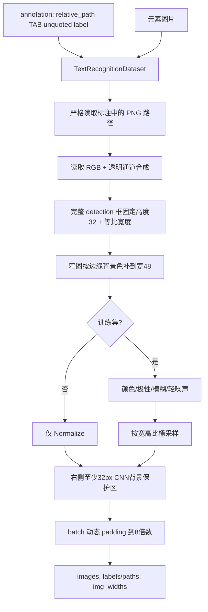
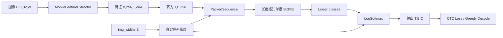
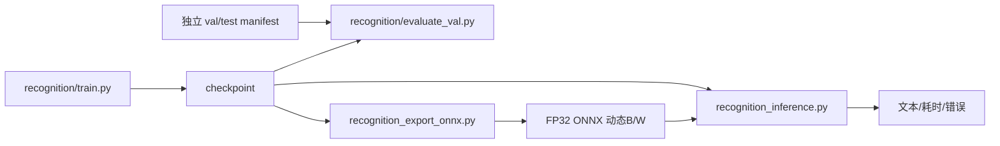

# Recognition 架构

## 1. 职责

Recognition 接收 detection 输出的单个文字框，输出 Unicode 文本。当前它是项目的实际主链路，支持彩色/深浅背景、PNG 和动态宽度处理。

当前基线为 MobileNet 风格 CNN + 单层双向 GRU + CTC head，输入高度固定为 32，宽度按比例缩放并在 batch 内动态 padding。

## 2. 数据与预处理



相关实现：

- `recognition/components/dataset.py`：图片路径校验、PNG 透明通道处理、缩放、增强、桶采样和动态 padding；
- `recognition/utils/checkpoint.py`：checkpoint 解包以及旧灰度/新 RGB 模型通道识别；
- `recognition/components/converter.py`：字典编码和显式 TBC/BTC 的 CTC greedy decode。

训练、验证、PyTorch 推理和多后端推理复用同一套不裁剪基础预处理。训练可额外使用随机增强；验证和测试禁止随机增强。

### 初始训练集/验证集划分

当 `all_images/` 和 `all_annotation.txt` 保存全量数据时，使用
`recognition/split_dataset.py` 做确定性的 80/20 均匀系统抽样。脚本按标注顺序每隔约
5 条抽取一条到验证集，其余进入训练集；总数不能被 5 整除时，会在 4～5 条之间
均匀调整间隔，使验证集数量等于最接近 20% 的整数。

```bash
# 先校验数据并预览数量，不修改文件
.venv/bin/python recognition/split_dataset.py

# 确认后从 all_images 复制图片，并生成 train/val 标注
.venv/bin/python recognition/split_dataset.py --apply
```

脚本不会修改 `all_images/` 和 `all_annotation.txt`。为避免覆盖手工调整，
`train_images/`、`val_images/`、`train_annotation.txt`、`val_annotation.txt` 必须为空；
缺图、重复标注、未标注 PNG 或目标文件冲突也会让脚本在写入前停止。

### 四份标注校对

手工调整 train/val 或隔离字典外字符样本后，运行下列只读脚本校对四份标注：

```bash
.venv/bin/python recognition/utils/check_dataset_annotations.py
```

脚本仅按不含目录的图片文件名判断，例如 `du20260902-002391.png`。它要求
`all = train + val + val_unknown`、三个子集两两没有同名图片，并逐项比较 all 与所属
split 中同名图片后面的识别文字。校对通过返回 0；缺失、多余、跨 split 重复或文字不同
会列出具体文件名并返回 1。每类默认最多显示 20 条详情，传入 `--max-details 0` 可显示全部。

### 字符频次与数据集覆盖率

```bash
# 默认统计 train、val、synthesis 三份标注，按合计占比倒序打印全部字符，并将完整明细写入 CSV
.venv/bin/python recognition/utils/character_stats.py

# 终端只显示“王”的次数和占比，CSV 仍保留 keys 中的全部字符
.venv/bin/python recognition/utils/character_stats.py --chars 王

# 按 train.py 的五份训练标注统计，排除 val
.venv/bin/python recognition/utils/character_stats.py \
  --annotations recognition/data/train_annotation.txt \
  recognition/data/append_annotation.txt recognition/data/bench1_annotation.txt \
  recognition/data/bench2_annotation.txt recognition/data/synthesis_annotation.txt \
  --output-dir outputs/recognition_training_character_stats
```

只生成 `outputs/recognition_character_stats/character_stats.csv`，不再生成 JSON。
CSV 和终端均按未舍入的合计占比倒序输出，同频保持 keys 原顺序，零出现字符也保留；
只列 keys 中的字符，不修改 keys。占比列在前，次数列统一放在最后。
默认列顺序为 `字符、train_占比、val_占比、synthesis_占比、合计_占比、
train_次数、val_次数、synthesis_次数、合计_次数`。
`次数` 包括同一标签内重复出现的字符；`占比` 为该字符次数除以对应文件全部文字字符数
（含字典外字符），直接显示百分数，保留五位小数，例如 `0.00000%`。出现 80 次、总共
1,000 个字符时，占比为 `8.00000%`。合计占比为所有输入文件的该字总次数除以文字总字符数，不是各占比平均。
合计累加本次传入的全部标注记录，不去重，默认包含 val，不能当作训练集总量。
终端同时提供各文件及合计的文字总字符数，方便核对分母。
默认运行也会在终端逐行打印全部字符；`--chars` 只限制终端展示，不过滤输出文件。
`outputs/` 在 `.gitignore` 中，编辑器全局搜索可能排除它；直接打开文件搜索，或显式运行
`rg -n 王 outputs/recognition_character_stats/character_stats.csv`。
脚本复用训练的 Tab 解析和首尾空白处理规则，不进行标点、Unicode 或转义归一化；
空标签按训练规则跳过并计数，格式错误直接报告具体文件与行号。此脚本不检查图片。

### 按字符统计移除补充数据

`recognition/utils/remove_characters_by_stats.py` 使用上述默认 CSV，并核对当前
`keys.txt` 和 train、val、synthesis 三份标注中的实际字符次数。
CSV 缺列、字符集合或次数不一致时停止，需先重新运行 `character_stats.py`。

两种方式均要求字符在 train 和 val 中出现次数为 0：

- `--mode 1`：synthesis 出现次数严格小于 10，包含零次字符。
- `--mode 2`：在目标数据集中恰好一份出现；当前目标只有 synthesis，因此选中其中所有出现过的字符，次数不限。
- `--mode both`：两种方式取并集，也是默认方式；当前会选中所有 train/val 次数为 0 的字典字符，包括 synthesis 零次字符。仅根据本次 CSV 筛选一次，不递归清理。

```bash
# 默认只预览，并打印全部命中字符、各文件删除数量及前 20 条图片明细
.venv/bin/python recognition/utils/remove_characters_by_stats.py

# 单独预览第二种方式；0 表示显示全部图片明细
.venv/bin/python recognition/utils/remove_characters_by_stats.py --mode 2 --max-details 0

# 真正执行两种方式的并集（也可以显式指定 --mode 1 或 --mode 2）
.venv/bin/python recognition/utils/remove_characters_by_stats.py --apply

# 只处理指定字符，仍须满足所选方式；不传 --apply 则只预览
.venv/bin/python recognition/utils/remove_characters_by_stats.py --chars 癫 --apply
```

只要标签包含命中字符，就删除对应的**整条标注和图片**，不会只删标签里的个别字。
只更新 synthesis 标注以及 keys 中命中的字符行，保留其余行内容、换行和
字典相对顺序。图片路径按标注文件所在目录解析并去重；待删图片缺失、路径越出数据目录、
通过符号链接访问，或仍被这三份文件中任一保留标注引用时，在写入前报错。
train、val 标注不修改，不扫描这三份标注之外的图片引用。

只有传入 `--apply` 才写入文件。执行前将所有待修改的原始标注、keys、待删图片及输入
CSV 备份到 `outputs/recognition_character_removal/removal-*/`；`manifest.json` 记录
原路径、备份路径及删除明细。单个文字文件使用原子替换，多文件操作不构成事务，若中断或
磁盘错误导致部分完成，可按 manifest 恢复。预览不创建备份或任何输出文件。
可用 `--csv`、`--keys`、`--data-dir`、`--backup-dir` 指定路径。
删除后需重新生成字符统计。删除整条样本会减少其他字符的次数、改变其数据集分布，
使本轮未命中的字符在下一轮满足条件；此时需基于新 CSV 再次预览、执行。
变更 keys 会改变模型 ABI，必须重新训练、导出并验证模型。

### 移除 train/val 已覆盖字符的合成样本

`recognition/utils/remove_common_synthesis.py` 专门处理
`recognition/data/synthesis1_annotation.txt` 和 `synthesis2_annotation.txt`。
读取 `outputs/recognition_character_stats/character_stats.csv` 的 `train_次数`、`val_次数`，
以 **train + val 合计 >= 100** 判断常见字，包含恰好 100 次；不使用包含 synthesis 的总次数
来判断是否需要补充。可用 `--threshold` 调整阈值。

- `--match all`（默认）：整条非空文字的每个字符均为常见字才移除，保留含低频字或 CSV 未收录字符的样本。
- `--match any`：包含任一常见字就移除整条样本，也会连带减少其中的低频字。

两种方式都按**整条标注和对应 PNG 图片**删除，不单独删标签中的字，不修改 keys、train、val。
预览打印两份标注的原条数、删除/保留条数、连带减少的低频字次数，以及合计从达标降到阈值以下
的字符数量。若所有样本都包含低频字，默认 `all` 会删除 0 条。

```bash
# 默认预览 all 规则，不写文件
.venv/bin/python recognition/utils/remove_common_synthesis.py

# 预览 any 规则，先检查连带减少的低频字数量
.venv/bin/python recognition/utils/remove_common_synthesis.py --match any

# 备份后按指定规则执行；此例采用 all
.venv/bin/python recognition/utils/remove_common_synthesis.py --match all --apply
```

复用现有清理工具的统计校验、备份和原子替换逻辑；检查四份标注实际次数与 CSV 一致，
待删 PNG 必须是数据目录内的普通相对路径且存在，并且未被四份文件中保留的标注引用。
不会扫描其他标注文件的引用。仅 `--apply` 执行写入，先将待改标注和待删图片备份到
`outputs/recognition_common_synthesis_removal/removal-*/`，同时保存原始 CSV 与 `manifest.json`。
多文件操作不是事务，异常中断可按 manifest 从备份恢复。执行后重新运行 `character_stats.py`。
支持 `--csv`、`--data-dir`、`--backup-dir` 和 `--max-details`；默认不执行真实数据删除。

### 补字合成数据

`recognition/utils/synthesis/generate.py` 使用
[oh-my-ocr/text_renderer](https://github.com/oh-my-ocr/text_renderer) 的
`FontText` 和 `draw_text_on_bg` 字形渲染接口。针对 `recognition/keys-append.txt`
每个字默认生成 100 张；配字仅取 `recognition/keys.txt` 中**非目标字**且当前字体支持的字符，
每张仅包含一个目标字，保证每个目标字的图片数和出现次数都严格等于 100。
字符文件要求每行一个可见字符、无重复；目标不在 keys 或没有字体支持时直接报错。
不修改 keys、现有训练/验证数据或训练配置。

```bash
# 可选工具依赖：锁定上游提交，只装绘字模块，保留现有训练依赖版本
.venv/bin/python -m pip install --no-deps -r recognition/utils/synthesis/requirements.txt

# 默认选择未占用的 synthesisN_images 目录
.venv/bin/python recognition/utils/synthesis/generate.py

# 小批量预览，输出到独立目录
.venv/bin/python recognition/utils/synthesis/generate.py --per-char 2 \
  --output-dir outputs/synthesis_preview/images \
  --annotation outputs/synthesis_preview/annotation.txt \
  --report-dir outputs/synthesis_preview/report
```

默认字体为本机思源黑体/宋体常规与粗体、Droid Sans Fallback、文鼎宋体；
不存在的默认字体不加入候选，没有覆盖目标字的字体则停止。也可通过 `--fonts file.ttf file.ttc`
指定字体文件；TTC 默认选择 Noto 简体中文比例字体、文鼎 CN 字形，逐字检查 cmap，
不以缺字方框替代文字。字体文件不复制到仓库。

默认按图片数量比例抽样 train_images/val_images 共 1,600 张，仅提取背景/前景色、
高度、文字占比与左右留白，不取验证集标注或复制真实含字像素。透明 PNG 通过共享
`load_rgb_image` 读取。合成 RGB PNG 高度 16～64、文本长度 1～24，按参考宽高比估计
长度，配字为随机字符组合；采用水平文字、完整字形、轻微模糊/噪声，不添加未标注文字。
默认种子 `20260907`，可用 `--seed`、`--per-char`、`--references`、`--style-samples` 调整。

输出：

- `recognition/data/synthesisN_images/synthesisN_YYYYMMDD_00001.png`：按系统日期和整批连续序号命名。
- `recognition/data/synthesisN_annotation.txt`：复用当前加载器的 `relative/path.png<TAB>文字`
  格式；当前代码已使用 Tab，AGENTS.md 中逗号加引号的描述是旧格式。
- `recognition/utils/synthesis/synthesis_report/synthesisN_YYYYMMDD/summary.json`：逐字计数、种子、字体计数、输入校验和。
- 同目录 `samples.jsonl`、`preview.png`：每张图的目标字/字体/参考风格及抽样预览。

图片和报告目录必须为空，标注必须不存在；失败保留已生成图片和 `.partial` 标注供排查，
不会覆盖或自动清理旧产物。成功后才原子发布正式标注。上述数据均被 Git 忽略。
默认从 N=1 开始，已有图片目录、标注、未完成标注或当天报告批次占用时自动递增编号。
使用合成数据训练时，将实际生成的 `recognition/data/synthesisN_annotation.txt` 加入
`recognition/train.py` 的 `TRAIN_ANNOTATION` 列表，验证集继续使用原来的 val 标注。

### 红章干扰合成（默认 1000 张）

`recognition/utils/synthesis/generate_red_stamp.py` 默认读取同目录
`red_stamp_references.txt` 中指定的 43 张参考框（train 29 张、val 14 张），提取正文颜色、
高度、留白、宽高比，以及红章颜色、相对直径、浓淡和覆盖率。参考图经过共享
`load_rgb_image` 读取，仅保留数值风格，不复制原图像素，不读取 val 标注。
其中 `train_images/000351-000003.png` 未测到明显红色，只提供正文风格，红章参数使用
其余参考的中位数；终端和报告明确标记 `red_measured=false`。整批参考都无红章时停止。

正文从 `train_annotation.txt` 中选择长度接近参考宽高比的整条文字，复用 `generate.py`
的字体渲染重新绘制。不是新增随机句子，也不限制到旧补字脚本的 24 字；这些参考主要是长行
正文，按中英文估计字宽选择整条标签，保留内部空格、标点和全部正文。字典外字符或整条文字
没有字体覆盖时在写入前报错。字体默认偏重宋体常规字重。

红章用程序绘制圆环、弧形章字、五角星，再截取上部、中部或下部局部与正文叠加；随机位置、
线宽、角度、透明度、轻微印泥不均匀和模糊。以乘色混合为主，模拟红印透出黑字。
每张都检查红章可见且与正文墨迹相交，不会生成完全未受章影响的样本。
**标注只包含正文，章中文字视作干扰，不加入标签**；这与原普通合成图无额外文字的用途不同。

```bash
# 默认生成 1000 张，文件名日期自动取系统当天
.venv/bin/python recognition/utils/synthesis/generate_red_stamp.py

# 小批量效果预览，使用独立输出路径
.venv/bin/python recognition/utils/synthesis/generate_red_stamp.py --images 43 \
  --output-dir outputs/red_stamp_preview/images \
  --annotation outputs/red_stamp_preview/annotation.txt \
  --report-dir outputs/red_stamp_preview/report
```

默认输出图片为 `recognition/data/synthesis_red_YYYYMMDD_images/YYYYMMDD_00001.png`，
标注为同级 `synthesis_red_YYYYMMDD_annotation.txt`，报告位于
`recognition/utils/synthesis/synthesis_report/synthesis_red_YYYYMMDD/`，包含 `summary.json`、逐图 `samples.jsonl`
和最多 40 张抽样的 `preview.png`。记录原 train 文本行号、字体、参考风格、章的位置和正文
重叠比例，便于复核。每张参考均匀采样；图数不少于参考数时，每张参考至少使用一次。
支持 `--images`、`--references`（清单路径，条目相对于 `--data-dir`）、`--corpus`、
`--fonts`、`--stamp-text`、`--seed` 及三个输出路径参数。

输出 RGB PNG 和 Tab 分隔标注，拒绝覆盖已有产物；失败保留 `.partial`，成功后才发布正式标注。
训练数据和配置不自动修改，使用时将新标注加入 `TRAIN_ANNOTATION`。本脚本是红章干扰增强，
不保证低频字符补齐配额，也不执行裁章或红色像素删除。

### 按统计补齐低频字（默认 50000 张）

`recognition/utils/synthesis/generate_balanced.py` 是独立的补齐入口，复用上述字体检查、
train/val 风格采样和 RGB 渲染。默认读取
`outputs/recognition_character_stats/character_stats.csv` 的**第一列字符和最后一列次数**，
只选中原次数严格小于 100 的字符（包含零次），新增次数为 `110 - 原次数`。
可用 `--target-count 100` 到 `120` 调整最终次数；原本已经达到 100 次的字不设补齐配额。
这里的最终次数是 **CSV 基线 + 本批新增标注中的字符出现次数**，同一图片内重复字也累加，
不是每字图片数，也不是仅训练集次数；默认 CSV 基线包含 train、val 和旧 synthesis。

```bash
# 先校验实际 CSV、字典、字体、参考图和全部 50000 条文字配额，不写文件
.venv/bin/python recognition/utils/synthesis/generate_balanced.py --dry-run

# 默认生成恰好 50000 张，年月日前缀自动取系统当天日期，无需传日期参数
.venv/bin/python recognition/utils/synthesis/generate_balanced.py

# 调整图片总数及最终字符次数
.venv/bin/python recognition/utils/synthesis/generate_balanced.py \
  --images 30000 --target-count 110
```

为同时满足图片总数和补齐次数，一张图可以包含多个目标字。先打乱全部缺口字符，
再均匀分配至 `--images` 张图；配字仅从 CSV 中已达到 100 次且 keys/当前字体支持的字中选取，
不会额外增加目标字次数。文字长度沿用参考图估计值；若容纳不下分配的目标字则扩长，
仍最多 24 字，颜色、高度与留白继续使用参考风格。图数不足以容纳全部缺口时提前报错，
不静默减少配额。每条文字须由同一个字体完整覆盖，缺字或配字不足会在写图片前报错。

日期在脚本启动时从系统本地时间读取一次，同一批跨午夜也保持一致；不提供 `--date` 参数。
以系统日期为 2026 年 9 月 8 日为例，默认输出为：

- 图片：`recognition/data/synthesis_balanced_20260908_images/synthesis_balanced_20260908_00001.png` 至 `synthesis_balanced_20260908_50000.png`。
- 标注：`recognition/data/synthesis_balanced_20260908_annotation.txt`，沿用实际加载器的 Tab 分隔格式。
- 报告：`recognition/utils/synthesis/synthesis_report/synthesis_balanced_20260908/`，包含逐字原次数/新增次数/最终次数
  `character_counts.csv`、`summary.json`、逐图 `samples.jsonl` 和 `preview.png`。

支持 `--output-dir`、`--annotation`、`--report-dir` 自定义输出；沿用空目录检查和标注原子发布，
拒绝覆盖旧产物，不自动修改训练配置或合并旧标注。后续再补齐前，应将本批标注纳入
`character_stats.py --annotations ...` 重新统计，并通过 `--stats` 指定新 CSV，避免重复使用旧基线。

## 3. 模型与张量契约



稳定契约：

- 输入图像：`float32 [B, C, 32, W]`，归一化到以 0.5 为 mean/std 的空间；
- `img_widths`：`int32/int64 [B]`，表示不含右侧背景保护区和 batch padding 的真实图片宽度；
- 输出：`float32 [T, B, num_classes]`，简称 TBC；
- 类别：0=`blank`，1=`UNK`，2 起来自 `keys.txt`；
- `keys.txt` 的内容和顺序是模型 ABI，变更字典必须训练/导出新模型版本；
- CNN 宽度下采样约为 4 倍，CTC 长度必须依据每张图片真实宽度计算。

`LabelConverter.decode` 已要求显式 `layout="TBC"` 或 `"BTC"`。部署入口会用已知 batch size 和类别数把后端输出规范为 TBC，不再用维度大小关系猜测。

每张图片右侧固定增加 32 px 背景保护区，隔离 CNN 感受野与动态 batch 边界；BiGRU 使用 `PackedSequence`，正反向都只处理各图片的有效时间步。自动测试要求同一图片在 batch=1 和混合宽度 batch 中的有效输出一致，并验证 ONNX GRU 带有 `sequence_lens` 输入。

## 4. 训练、评测、导出与推理



主入口：

- `recognition/train.py`：训练与训练期验证；
- `recognition/evaluate_val.py`：独立 manifest 的 Accuracy/CER/错误样本；
- `recognition/inference.py`：PyTorch checkpoint 调试；
- `recognition_export_onnx.py`：带 `img_widths`、动态 batch/width 的 ONNX；
- `recognition_inference.py`：ONNX/OpenVINO/PyTorch 部署推理。

`train.py` 的 `TRAIN_ANNOTATION` 可配置一个标注路径或多个标注路径；当前训练集按配置顺序
合并 `train_annotation.txt`、`append_annotation.txt`、`bench1_annotation.txt`、
`bench2_annotation.txt` 和 `synthesis_annotation.txt`，各文件内的图片路径分别相对于
自身所在目录解析。

示例：

```bash
python recognition/train.py

# evaluate_val.py 当前仍使用文件顶部常量，不支持命令行参数。
# 先配置 MODEL_PATH、启用一个 VAL_ANNOTATION，并为本次评估设置 ERROR_OUTPUT_FILE。
.venv/bin/python recognition/evaluate_val.py

python recognition_export_onnx.py \
  --model_path recognition/checkpoints/<model>.pth \
  --output_path artifacts/recognition/<version>/model.onnx \
  --keys_path recognition/keys.txt \
  --img_height 32 \
  --img_width 256

python recognition_inference.py \
  --model_path artifacts/recognition/<version>/model.onnx \
  --backend auto \
  --keys_path recognition/keys.txt \
  --image_path recognition/data/test_images1 \
  --batch_size 32
```

初次准备数据时，应先从 `all` 使用上述划分脚本建立图片与标注一一对应的独立训练集
和验证集，并运行三份标注校对；划分完成前，不应将训练集评估结果作为发布精度。

## 5. 评测维度

总体 Accuracy/CER 之外，至少按以下网页场景报告：

- `menu-white-text`：菜单、按钮、有色/深色背景白字；
- `small-text-or-sparse`：小文字、大背景、文字占比低；
- `has-icon-or-arrow`：箭头、图标、角标邻接；
- `long-text`：长文本、空格和中英文标点；
- `light-dark-theme`：浅色/深色主题；
- `scale-dpr`：浏览器缩放和不同设备像素比；
- `unknown-char`：字典外字符和规范化策略。

门禁必须包含：跨 split 重复为 0、冲突 label 为 0、batch 一致率 100%、PyTorch/ONNX 文本一致率 100%、关键分组不低于已批准基线。阈值和基线报告都要版本化。

## 6. 已知问题与演进边界

- `train.py` 仍以脚本常量为主，需迁移为可序列化配置与 run manifest。
- 训练数据与标注统一使用 `.png`；路径或扩展名不一致会直接报错，避免自动回退掩盖数据问题或以 dummy tensor 静默污染训练。
- recognition 不再做二次裁剪；detection 框质量需要在 detection 环节单独评估。
- 输入高度目前固定 32；48 高度只能作为同数据、同训练预算的消融实验，不能直接替换现有权重。
- `recognition_quantize_static.py` 当前不进入发布路径。FP32 ONNX/OpenVINO 是默认优化方向。
- `model_resnet50.py` 和历史说明文档属于实验资产，未通过同一门禁前不替代当前基线。

2026-09-07 对 dataset 历史改动、红章增强和训练机制的复核见
[专项分析](recognition-analysis-2026-09-07.md)。报告区分本次像素/机制测量与尚待完成的
训练精度对照，没有改变上述训练或推理契约。
