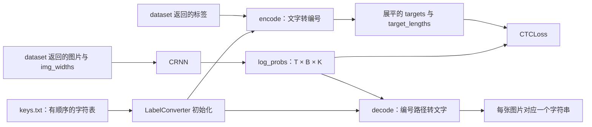
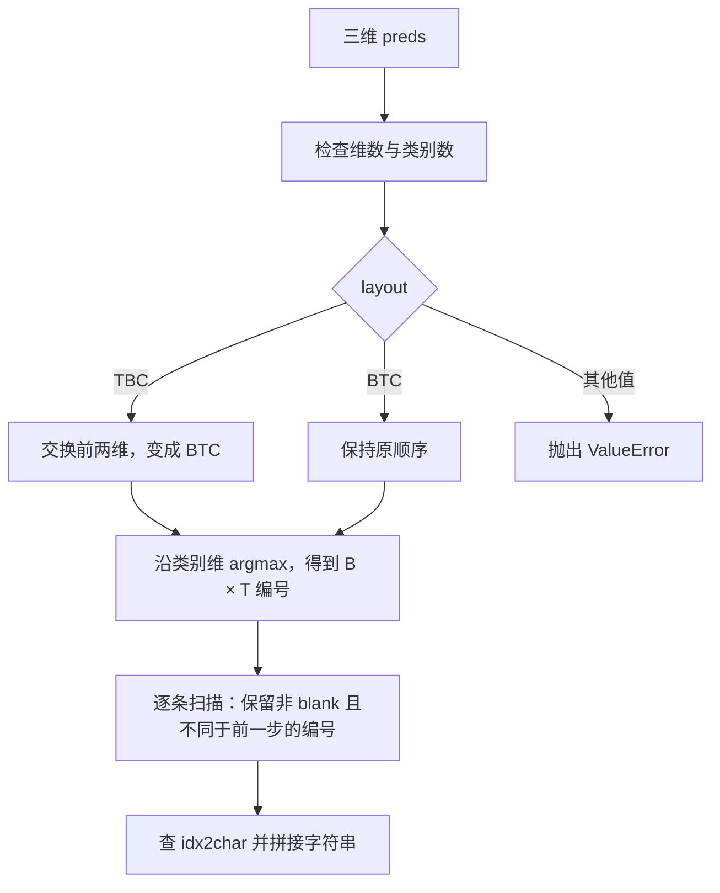

# converter.py：文字与 CTC 类别编号之间的转换

分析对象：[recognition/components/converter.py](../../recognition/components/converter.py)。本文依据 2026-09-07 的工作区代码。

**先记住一句话：`LabelConverter` 管理“哪个编号代表哪个字”，训练时把标签变成整数，推理时把模型预测的整数路径合并成文字。** 它不读取图片，也不运行神经网络。

配套阅读：[dataset.py 分析](dataset-analysis.md)负责图片与标签，[model.py 分析](model-analysis.md)负责生成预测；整体约定见 [Recognition 架构](../recognition.md)。

## 1. 在识别链路中的位置



这里用 `B` 表示 batch 中的图片数，`T` 表示模型的时间步数，`K` 表示类别数。一个时间步是 CNN 沿图片宽度提取出的一个位置，不等于一个最终字符。

整个文件只有一个类，建议按下面的顺序阅读：

| 入口 | 输入 | 输出 / 作用 |
| --- | --- | --- |
| `LabelConverter(keys_path)` | UTF-8 字符表路径 | 建立 `char2idx`、`idx2char` 和 `num_classes` |
| `encode(text)` | 一批字符串，例如 `["你好", "你 A"]` | 两个一维 `torch.long` 张量：字符编号、每条标签的长度 |
| `decode(preds, *, layout)` | 三维类别分数，以及显式的维度顺序 | `list[str]`，顺序与输入 batch 一致 |

## 2. 初始化：先固定“字符编号表”

假设一个教学用 `keys.txt` 由 `"你\n好\nA\n \n"` 写成，四行依次是“你”“好”“A”和一个普通空格。初始化后：

| 编号 | 字符 / 标记 | 含义 |
| --- | --- | --- |
| `0` | `[blank]` | CTC 对齐占位，解码时不输出文字 |
| `1` | `[UNK]` | 字典外字符的统一编号 |
| `2` | `你` | 字符表第一行 |
| `3` | `好` | 字符表第二行 |
| `4` | `A` | 字符表第三行 |
| `5` | 普通空格 `" "` | 真正的文字字符，解码后会保留 |

正常字符的编号从 `2` 开始。这个例子的 `num_classes` 是 `6`，创建模型时应使用 `n_class=converter.num_classes`。

读取字符表时，代码只去掉行尾换行相关字符，不会调用无参数的 `strip()`，因此一行中的普通空格会保留；真正的空行会跳过。初始化还会打印是否读到了空格，以及字典和类别数量。

### 字符表顺序属于模型的一部分

模型分类头的第 `2` 列只知道自己是“类别 2”；它究竟代表“你”还是“好”，由字符表决定。如果只交换字符表前两行，模型仍然输出相同分数，解码结果却会把这两个字互换。

因此，**同一个 checkpoint、导出模型和 converter 必须使用相同内容、相同顺序的字符表**。只检查类别数量相等无法发现字符顺序错误。按照仓库约定，修改 `keys.txt` 后需要重新训练、导出并验证模型。

当前构造函数没有完整检查字符表合法性，接手时还应知道这些边界：

- 预期每行一个字符，但代码会把整行加入字典；`encode()` 又逐个 Python 字符查表，多字符行不会按词匹配。
- 重复字符会覆盖 `char2idx` 中的旧映射，但 `idx2char` 仍保留旧编号，可能造成编号超出 `num_classes` 的有效范围。
- `num_classes` 实际取 `len(char2idx)`；只有字典正常、无重复和保留标记冲突时，才等于 `len(keys) + 2`。
- 不进行 Unicode 归一化或繁简、全半角转换。视觉相似的字符仍可能是不同类别。

这些是现有实现的使用前提，并不表示当前仓库字符表已经出现了这些问题。

## 3. encode：把一批标签展平成一条整数序列

继续使用上面的教学字典：

```text
输入标签                  各自编码                  长度
"你好"                   [2, 3]                    2
"你 A"                   [2, 5, 4]                 3
"吗"                     [1]                       1

encoded_texts = [2, 3, 2, 5, 4, 1]
lengths       = [2,    3,       1]
```

返回值不是 `[B, 最大标签长度]` 的矩阵，而是 CTC 支持的**一维拼接标签**。`lengths` 告诉损失函数如何重新划分：前 2 个编号属于第一张图，接着 3 个属于第二张，最后 1 个属于第三张。

需要区分三种“长度”：

| 名称 | 单位 | 来源 |
| --- | --- | --- |
| `img_widths` | 像素 | dataset 在 batch padding 前记录 |
| `input_lengths` / 训练脚本中的 `preds_size` | 模型时间步 | 由图片真实宽度经过 CNN 下采样公式计算 |
| `target_lengths` / `encode()` 返回的 `lengths` | 标签字符数 | 每个字符串被遍历了多少个字符 |

例如，一张真实宽度为 `64` 的图可提供 `16` 个有效时间步，而标签“你好”只有 `2` 个字符；CTC 负责在两者之间寻找对齐方式。

`encode()` 不会自动插入 blank，也不会去掉重复字符或空格。字典外字符会占据一个 `[UNK]` 编号，长度照常加一，而不是从标签里消失。返回的两个张量都在 CPU，类型为 `torch.long`；训练脚本负责后续设备转换。

注意：虽然附近注释提到了避免刷屏，当前未知字符的 `print()` 实际处于启用状态，每次调用遇到未知字符都会打印。字符串长度按 Python 逐字符遍历计算，不是按用户看到的组合字形或单词计算。

## 4. decode：先选类别，再执行 CTC 合并



### 第一步：明确 TBC 和 BTC

```python
# CRNN 的原生输出：[时间步, 图片数, 类别数]
texts = converter.decode(preds, layout="TBC")

# 如果调用方已经转成：[图片数, 时间步, 类别数]
texts = converter.decode(preds.transpose(0, 1), layout="BTC")
```

`layout` 是必须通过关键字传入的参数。不能根据“哪一维更大”猜时间维，因为短图的时间步数可能少于 batch 图片数。传错一个仍然合法的 layout，通常不会触发类别检查，却会把 batch 维当作时间维处理。

模型输出的是 `log_softmax` 后的对数概率，但这里仅使用 `argmax`。对于同一组分数，logits、softmax 概率和 log_softmax 对数概率的最大类别相同，因此解码前不需要再做一次 softmax。

### 第二步：理解“重复”与 blank 的先后关系

假设每个时间步的最大类别如下：

```text
原始编号：  [2,   2,   0,       2,   3,   3,   0,       5,      4,   4]
对应字符：   你   你   blank    你   好   好   blank    空格    A    A
合并结果：  "你你好 A"
```

代码比较的是**当前编号与原始路径的前一个编号**。因此：

| 原始路径 | 解码结果 | 原因 |
| --- | --- | --- |
| `你 → 你` | `你` | 相邻重复合并 |
| `你 → blank → 你` | `你你` | blank 隔开了两个相同字 |
| `blank → blank` | 空字符串 | blank 不输出 |
| `你 → 普通空格 → 好` | `你 好` | 普通空格是有效字符 |
| `UNK → UNK` | `[UNK]` | UNK 按普通非 blank 类别处理 |

不能先把 blank 全部删除，再对剩余序列去重，否则“你你”也会被错误合成“你”。另外，预测到 UNK 时，输出的是字面字符串 `[UNK]`，并不能恢复原来的未知字。

### decode 不知道每张图的真实长度

这个接口只接收 `preds` 和 `layout`，会扫描完整的 `T` 个时间步。主链路依靠 `CRNN.forward(..., img_widths=...)` 把无效时间步固定成 blank，所以这些位置不会生成尾部杂字。

若使用其他模型或漏传 `img_widths`，不能指望 converter 自动判断哪些时间步属于 padding。它也不做 beam search、语言模型纠错、置信度计算或图片后处理。

## 5. 可运行的小例子

在仓库根目录用 `.venv/bin/python` 运行以下代码。它只在临时目录创建教学字典，不需要模型权重：

```python
from pathlib import Path
from tempfile import TemporaryDirectory

import torch

from recognition.components.converter import LabelConverter

with TemporaryDirectory() as temp_dir:
    keys_path = Path(temp_dir) / "keys.txt"
    keys_path.write_text("你\n好\nA\n \n", encoding="utf-8")
    converter = LabelConverter(str(keys_path))

    targets, lengths = converter.encode(["你好", "你 A", "吗"])
    assert targets.tolist() == [2, 3, 2, 5, 4, 1]
    assert lengths.tolist() == [2, 3, 1]

    # 人工构造每个时间步的最高分类分数，演示解码规则。
    token_ids = [2, 2, 0, 2, 3, 3, 0, 5, 4, 4]
    scores = torch.full((len(token_ids), 1, converter.num_classes), -10.0)
    for time_step, token_id in enumerate(token_ids):
        scores[time_step, 0, token_id] = 0.0

    assert converter.decode(scores, layout="TBC") == ["你你好 A"]
    assert converter.decode(scores.transpose(0, 1), layout="BTC") == ["你你好 A"]
    print(targets.tolist(), lengths.tolist(), converter.decode(scores, layout="TBC"))
```

这里的 `scores` 是人为指定的分类分数，仅用于演示；不是某个已训练模型的识别结果。

## 6. 接手时如何定位问题

| 现象 | 优先检查 |
| --- | --- |
| 输出类别数不匹配 | checkpoint 分类头、`keys.txt` 和 `converter.num_classes` 是否一致 |
| 类别数相同，但很多字稳定地变成别的字 | 是否替换或重排过字符表 |
| 训练不断提示未知字符 | 原始标签有哪些字不在字典里；先检查标注与字符表 |
| 连续相同的字只剩一个 | 模型是否学到了两字间的 blank，或是否错误修改了解码合并规则 |
| 一张图对应多个异常字符串 | `layout` 是否写错，batch 与时间维是否颠倒 |
| batch 中出现长图后，短图尾部多字 | 继续检查 dataset 的 `img_widths` 和模型的 padding 处理 |

实际调用可从 [recognition/train.py](../../recognition/train.py) 中的 `converter.encode`、`converter.decode` 入手；部署入口是 [recognition_inference.py](../../recognition_inference.py)。

[test_recognition_batch_invariance.py](../../tests/test_recognition_batch_invariance.py) 中的 `test_ctc_decode_uses_explicit_layout_when_time_is_shorter_than_batch` 验证了 `T < B` 时两种显式 layout 解码一致。上面的教学例子补充展示了标签展平、UNK 和重复字符合并的具体结果。
