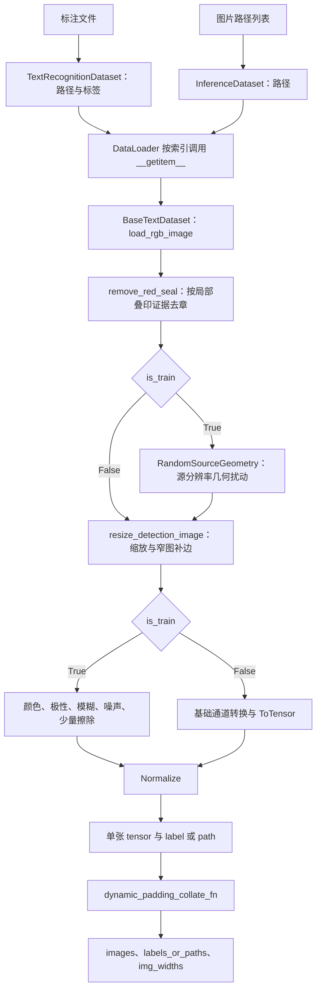
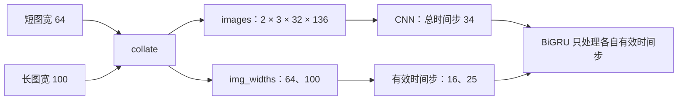

# dataset.py：从图片和标注到模型输入

本文帮助新手理解图片与标注如何经过加载、去章、缩放、增强和补边，成为带真实宽度的模型输入。

代码入口：[recognition/components/dataset.py](../../../../recognition/components/dataset.py)。已于 2026-09-13 对照当前实现核对；修改相关实现时同步更新本页。

确定性预处理位于 [preprocessing.py](../../../../recognition/components/preprocessing.py)：`resolve_image_path`、`load_rgb_image`、`border_fill_color`、`remove_red_seal` 和 `resize_detection_image` 不在 `dataset.py` 中定义。随机增强位于 [augmentation.py](../../../../recognition/components/augmentation.py)：`RandomSourceGeometry`、`AddGaussianNoise` 和 `build_transform`。`dataset.py` 负责数据集、分桶、补边并调用这两个模块。训练用的标注路径、输入尺寸、批大小和加载进程数由 [training_data.py](../../../../recognition/training_data.py) 配置，并由其 `create_training_loaders()` 调用本页的 `create_dataloader()`。

**`dataset.py` 与 `preprocessing.py`、`augmentation.py` 配合，把大小不同的 detection 文字框整理成可以一起送入模型的图片张量，同时保留每张图自己的真实宽度。** 训练与推理共享图片处理逻辑，区别主要是是否增强、返回标签还是路径。

配套阅读：[model.py 导读](model-analysis.md)说明真实宽度如何控制模型，[converter.py 导读](converter-analysis.md)说明标签如何变成 CTC 编号；整体约定见 [Recognition 架构](../../recognition.md)。

## 1. 先看最终交付给模型的三个东西

```python
images, labels_or_paths, img_widths = next(iter(dataloader))
```

| 返回值 | 形状 / 类型 | 用途 |
| --- | --- | --- |
| `images` | 常规运行时为 CPU `float32 [B, C_img, H, W_batch]` | 补齐后的图片；主链路 `C_img=3`、`H=32` |
| `labels_or_paths` | 长度为 `B` 的字符串元组 | 训练/验证时是标签，推理时是图片路径 |
| `img_widths` | CPU `int32 [B]` | 每张图在 collate 补边前的像素宽度 |

`B` 是图片数，`C_img` 是图像通道数，`W_batch` 是这批图片共同使用的画布宽度。

**`img_widths` 包含缩放后为窄图补出的最小画布，但不包含 CNN 右侧保护区和 batch 补齐部分。** 它既不是原始图片宽度，也不是仅包住文字笔画的宽度。

## 2. 文件地图与调用顺序

| 代码对象 | 负责什么 |
| --- | --- |
| `resolve_image_path`（preprocessing.py） | 检查指定路径是否确实是文件 |
| `load_rgb_image`（preprocessing.py） | 读取图片、修正 EXIF 方向、合成透明背景并转 RGB |
| `border_fill_color`（preprocessing.py） | 用图片四周边缘估计窄图补边和几何增强的填充色 |
| `remove_red_seal`（preprocessing.py） | 根据局部叠印证据去章，保护同行红字 |
| `RandomSourceGeometry`（augmentation.py） | 缩放前扰动检测框几何，按墨迹外接框重裁 |
| `resize_detection_image`（preprocessing.py） | 固定高度缩放，限制最大宽度，为窄图补画布 |
| `AddGaussianNoise`（augmentation.py） | 给训练张量增加轻微高斯噪声 |
| `BaseTextDataset` | 共享加载、去章、缩放、增强和归一化逻辑 |
| `TextRecognitionDataset` | 读取一个或多个标注文件，返回 `(image, label)` |
| `InferenceDataset` | 接收图片路径列表，返回 `(image, path)` |
| `BucketBatchSampler` | 按宽高比安排训练 batch，减少无用 padding |
| `dynamic_padding_collate_fn` | 把单张张量组合成 batch，返回真实宽度 |
| `create_dataloader` | 创建训练/验证用的 Dataset、Sampler 和 DataLoader |



上图中的训练增强内部也包含可选灰度转换和 `ToTensor()`，完整顺序见第 5 节。

新接手时，建议先读 `_load_and_process_image()` 和 `dynamic_padding_collate_fn()`，弄清一张图片怎样变成一个 batch，再回头读标注解析与采样器。

## 3. 数据集创建时做什么，取样时做什么

### TextRecognitionDataset：先检查清单，再按需读取图片

构造时读取标注，维护两条同序列表：

```text
image_paths = [".../short.png", ".../long.png"]
labels      = ["你好",          "你 A"]

dataset[0] -> (第一张图的 tensor, "你好")
```

构造过程会检查图片是否存在，但不会把所有图片像素都装进内存。真正解码图片和执行预处理发生在 `__getitem__()` 调用基类方法时；训练用的桶采样器还会额外预扫描图片尺寸。

`annotation_path` 可以是单个字符串 / `Path`，也可以是路径列表。多个文件按传入顺序合并，每个文件内的相对图片路径都以**该标注文件所在目录**为基准。例如：

```text
/tmp/ocr-a/train.txt   中的 short.png -> /tmp/ocr-a/short.png
/tmp/ocr-b/append.txt  中的 long.png  -> /tmp/ocr-b/long.png
```

加载器本身不负责去重、解决冲突标注或检查 train/val 交集，这些属于数据准备与划分环节。

### 当前标注格式：以实际解析代码为准

当前委托 [recognition/utils/annotation.py](../../../../recognition/utils/annotation.py) 的 `split_annotation_fields()` 解析，格式是：

```text
relative/path.png<TAB>文字内容
```

`<TAB>` 表示一个真正的制表符。用 Python 表示一条实际记录是 `"short.png\t你好\n"`，不要把 `<TAB>` 这五个字符写进文件。

该格式与仓库 `AGENTS.md` 的数据契约一致。旧逗号分隔标注需要先转换，加载器不会自动兼容。

具体规则容易影响训练标签：

- 按第一个 Tab 分成路径和文字，文字中的逗号不用于分隔。
- 路径会去掉首尾空白；dataset 还会对文字字段调用 `strip()`，因此文字内部空格保留、首尾空白移除。
- 不会自动去掉包裹标签的引号；若写入 `"你好"`，两个引号也属于标签字符。
- 路径必须精确存在，不猜扩展名，也不尝试同名图片。项目数据约定使用 `.png`，但 `resolve_image_path()` 本身仅检查文件存在，没有强制限制后缀。

### InferenceDataset：用路径代替标签

构造时逐个检查路径，始终使用 `is_train=False`；单张返回 `(tensor, path)`。`dynamic_padding_collate_fn()` 不解析第二项的内容，因此同一函数可以同时服务训练与推理。

这里 `img_width` 的默认值是 `None`，表示不限制缩放后的最大宽度；训练数据集则由调用方提供这个参数。共享预处理函数并不意味着所有入口的最大宽度配置一定相同。

### 错误会在哪一步暴露

| 情况 | 当前行为 |
| --- | --- |
| 标注文件列表为空 | 构造时抛出 `ValueError` |
| 标注文件不存在 | 构造时抛出带路径的 `FileNotFoundError` |
| 空白行、缺 Tab、路径字段为空 | 记为格式错误，读完当前标注文件后整体报错 |
| 非空标签对应的图片不存在 | 汇总缺图信息后整体报错，不返回一个悄悄删减过的数据集 |
| 标签经 `strip()` 后为空 | 跳过并统计打印；这一分支不会继续检查图片 |
| 图片文件存在，但无法正常预处理 | 取样时抛出带图片路径的 `RuntimeError`，原异常保留在异常链中 |

格式错误与缺图各展示前 5 条，便于定位。文件顶部启用了 `ImageFile.LOAD_TRUNCATED_IMAGES=True`，Pillow 可能接受部分截断图片，因此它并不构成完整的数据完整性检查。

## 4. 一张图片的基础处理

### 4.1 load_rgb_image：保留透明 PNG 上的文字

先做 EXIF 方向修正，然后判断透明情况：

| 图片情况 | 处理 |
| --- | --- |
| 没有透明通道 / 透明信息 | 转为 RGB |
| 有 alpha，但所有像素都完全不透明 | 直接转 RGB |
| 整张图完全透明 | 合成白色背景 |
| 有可见内容，平均亮度 `>=128` | 用黑底合成，帮助保留白色等亮内容 |
| 有可见内容，平均亮度 `<128` | 用白底合成，帮助保留黑色等暗内容 |

平均亮度由 alpha 掩码下的可见像素计算。比如“透明底黑字”会配白底，“透明底白字”会配黑底，避免直接丢弃 alpha 后字与背景难以区分。

这是基于整体可见亮度的背景选择，不会识别文字区域或分别为每个字选择底色。混合亮暗内容的实际可读性仍取决于输入图片。

### 4.2 remove_red_seal：在缩放前按局部证据去章

训练、验证和推理都在透明背景合成之后、缩放和随机增强之前调用此函数。它先要求浅色纸面和足够的灰黑正文，再检查局部红色区域与正文的穿插、上下错位关系；通过区域检查后，还会逐个连通区域复核正文支持。

只有符合条件的红像素被替换为纸面中位色，不膨胀删除掩码，也不改变图片尺寸。完全落在正文行内的小红字及缺少正文支持的红色区域会保留。该规则可能留下与正文对齐的章字碎片，也不能恢复已经被章遮住的笔画；特殊排版的合法红色内容仍需用实际样本核对。

核对时比较原图与 `remove_red_seal(load_rgb_image(path))`：正文和合法红字应保留，改动只应落在叠印红章区域。具体判断见源码，术语见[术语表](../../../terminology.md)。

### 4.3 resize_detection_image：固定高度，保留完整 detection 框

常规缩放宽度为：

```text
resized_width = max(1, round(原图宽 × target_height / 原图高))
若提供 max_width，再取 min(resized_width, max_width)
```

随后用 LANCZOS 插值将**整张图**缩放到该宽度和目标高度。主链路目标高度为 `32`；这个函数本身可以接受其他正高度，但当前 CRNN 构造器要求高度为 `32`。

| 原图宽 × 高 | 目标高度 | 最大宽度 | 缩放与补边后的宽 × 高 |
| --- | --- | --- | --- |
| `180 × 80` | `32` | `1800` | `72 × 32`，正常等比缩放 |
| `200 × 64` | `32` | `1800` | `100 × 32`，正常等比缩放 |
| `10 × 40` | `32` | `1800` | 先缩到 `8 × 32`，再放进 `48 × 32` 画布 |
| `4000 × 32` | `32` | `1800` | `1800 × 32`，触及上限后发生横向压缩 |

最后一行是一个需要留意的实现细节：函数通常等比缩放，但触及最大宽度时仍保持目标高度，因而不再严格等比。它压缩整张图片，没有裁掉尾部内容；长文字会变得更密。

`img_width` / `max_width` 是上限，不是所有图片都要拉伸到的固定宽度，也不是最终 batch 画布宽度。

### 4.4 窄图为什么补到 48

默认 `MIN_IMAGE_WIDTH=48`。缩放后不足这个宽度时，代码用四周边缘像素的中位数估计背景色，创建画布并水平居中贴入图片，以保留字符比例。若最大宽度小于 48，补边也受该上限约束。

例如 `10 × 40` 的单字图先变成 `8 × 32`，再左右各补 `20` 像素，最终宽度 `48`。collate 后记录的 `img_widths` 是 `48`，不是 `8`，更不是原图宽 `10`。

整个基础处理使用完整 detection 框，不做二次文字裁剪，去章只处理满足上述局部证据的红像素。

## 5. 训练增强与验证 / 推理的区别

`num_channels` 仅支持 `1` 或 `3`。图片总是先经过共享 RGB 加载；若需要兼容灰度模型，再在 transform 中转为单通道。当前训练入口显式使用 `3` 通道。

训练前先在**缩放前**用 `RandomSourceGeometry` 改写检测框几何（`recognition/components/augmentation.py`），
再在缩放后执行 transform。以下顺序中，几何扰动是第 0 步：

| 顺序 | 操作 | 当前配置 |
| --- | --- | --- |
| 0 | `RandomSourceGeometry`（源分辨率） | 补边 `p=0.5`、每边 `0～3 px`；等比缩放 `p=0.5`、`0.85～1.18`；横向拉伸 `p=0.4`、`0.90～1.10`；旋转 `p=0.5`、`±2°` 且按长宽比收紧；单侧轻裁 `p=0.2`、`1 px`。斜切/透视/弹性扭曲默认 `p=0`，仅保留实现供消融 |
| 1 | `ColorJitter` | `p=0.7`；亮度 `0.2`、对比度 `0.25`、饱和度 `0.35`、色相 `0.03` |
| 2 | 自动对比度 | `p=0.2` |
| 3 | 颜色反转 | `p=0.08` |
| 4 | 可选灰度转换，然后 `ToTensor` | 根据 `num_channels`，变为 `[C_img, H, W]` |
| 5 | 高斯模糊 | `p=0.15`；核大小 `3`，`sigma=(0.1, 0.8)` |
| 6 | `AddGaussianNoise` | `p=0.15`；实际使用 `std=0.015`，加噪后截到 `[0, 1]` |
| 7 | 随机擦除 | `p=0.05`；面积比例 `0.005～0.03`，`value="random"` |
| 8 | `Normalize` | 各通道 `mean=0.5`、`std=0.5` |

`AddGaussianNoise` 的默认 `std` 由 `augmentation.py` 的 `NOISE_STD` 常量控制，当前为 `0.015`。
几何扰动在源分辨率完成：任一操作生效后按墨迹外接框重裁并重新采样留白，每边至少 1 px；
旋转在扩大的画布上完成，字形不会被截断，角度上限要求垂直跨度不超过文字高度的 30%。
这些操作会改变图片尺寸，`img_widths` 仍取缩放后的真实宽度，分桶使用的原图宽高比只是近似值。
随机擦除仍可能局部遮挡像素，不等同于完全不改变文字区域。

验证 / 推理仍执行前述共享加载、去章和缩放；其 transform 只做可选灰度转换、`ToTensor()` 和归一化。对于普通 8 位图片，像素变换是：

```text
原始像素 p -> p / 255 -> (p / 255 - 0.5) / 0.5
黑色 0     -> -1
中灰 128   -> 约 0.00392
白色 255   -> 1
```

验证 / 推理张量因此落在 `[-1, 1]`。训练中的随机擦除使用随机填充值，不应把严格落在该区间当作所有增强输出的保证。

## 6. collate：三种补边不要混淆

单张图片处理完成后仍然可能有不同宽度，无法直接 `torch.stack()`。`dynamic_padding_collate_fn()` 负责让它们具有相同形状。

| 处理 | 发生位置 | 是否计入 `img_widths` | 目的 |
| --- | --- | --- | --- |
| 窄图补到最小宽度 | 单张图片 resize 阶段 | 是 | 保留窄字符比例，提供最小画布 |
| 右侧至少 `32` 像素保护区 | collate 阶段 | 否 | 稳定 CNN 有效位置看到的右侧背景 |
| 按 batch 最长图补齐，并对齐到 `8` 的倍数 | collate 阶段 | 否 | 让所有图片组成同形状张量 |

假设两张图处理后分别为 `[3, 32, 64]` 和 `[3, 32, 100]`：

```text
img_widths = [64, 100]
先加右侧保护区：100 + 32 = 132
再向上对齐到 8 的倍数：W_batch = 136

第一张：[有效图片 64 px ][右侧背景 72 px]
第二张：[有效图片 100 px              ][右侧背景 36 px]

images.shape = [2, 3, 32, 136]
```

实现不会为“保护区”和“额外 batch padding”分别开辟张量；它们都是右侧连续的背景区域。代码保证即便是最长图，右侧也至少留有 `CNN_RIGHT_CONTEXT=32` 像素。

填充值不是统一的黑色或白色：**每张图取自己最右侧最多 4 列的像素，按通道计算中位数，并用该颜色填充自己的整个右侧区域。** 这里处理的已经是 transform 之后的张量，与前面窄图使用四周 PIL 像素估色不同。



右侧保护区解决 CNN 的边缘上下文问题，`img_widths` 则让模型和 CTC 知道哪里才是有效序列。具体原因见 [model.py 导读](model-analysis.md)。当前 collate 面向非空、同高度、同通道的 CPU 图片张量，不是任意 dtype / device 的通用拼接工具。

## 7. 桶采样器与 DataLoader 工厂

`BucketBatchSampler` 初始化时扫描 `dataset.image_paths` 的宽高比；每次迭代先排序索引，再每 `batch_size` 个切成一个 batch，最后按需要打乱 **batch 的顺序**。

```text
样本索引：      [0,   1,   2,   3]
宽高比：        [4,   1,   8,   2]
排序后索引：    [1,   3,   0,   2]
batch_size=2：  [[1, 3], [0, 2]]
shuffle 后：    可能是 [[0, 2], [1, 3]]
```

这样同一批图片宽度更接近，可减少 CNN 对空白区域的计算。它返回的是样本索引列表，不负责读取、缩放或拼接图片。

这也意味着当前实现每轮通常保留相同的分组成员，只打乱 batch 顺序，并非每轮重新随机组合所有样本。预扫描使用原始图片尺寸，没有应用 EXIF 方向修正、宽度上限或窄图补边，故排序只是一种近似优化。

如果尺寸扫描失败，sampler 暂用宽高比 `1.0`；后续真正读取该图片时仍走带路径异常的预处理，不会生成替代图片。

`create_dataloader()` 的分支如下：

| `is_train` | 单张处理 | batch 来源 | 尾部不满一批 |
| --- | --- | --- | --- |
| `True` | 开启随机增强 | `BucketBatchSampler(..., shuffle=True)` | 保留 |
| `False` | 确定性基础处理 | 按数据集原顺序，`shuffle=False` | 保留 |

两种分支都使用共享 collate，并启用 `pin_memory=True`。该工厂接受标注文件，所以负责训练 / 带标注验证；纯图片推理入口自行组合 `InferenceDataset` 和 `DataLoader`。

## 8. 可运行的小例子

在仓库根目录用 `.venv/bin/python` 运行。示例在临时目录创建两张纯色图，只演示尺寸、标签和补齐结果，不用于验证识别精度：

```python
from pathlib import Path
from tempfile import TemporaryDirectory

from PIL import Image

from recognition.components.dataset import create_dataloader

with TemporaryDirectory() as temp_dir:
    root = Path(temp_dir)
    Image.new("RGB", (64, 32), (20, 110, 180)).save(root / "short.png")
    Image.new("RGB", (200, 64), (240, 240, 240)).save(root / "long.png")
    annotation_path = root / "labels.txt"
    annotation_path.write_text("short.png\t你好\nlong.png\t你 A\n", encoding="utf-8")

    loader = create_dataloader(
        annotation_path=annotation_path,
        img_height=32,
        img_width=1800,
        num_channels=3,
        batch_size=2,
        num_workers=0,
        is_train=False,  # 关闭增强与桶采样，便于逐项核对。
    )
    images, labels, img_widths = next(iter(loader))

    assert images.shape == (2, 3, 32, 136)
    assert labels == ("你好", "你 A")
    assert img_widths.tolist() == [64, 100]
    print(images.shape, labels, img_widths.tolist())
```

## 9. 接手时如何定位问题

| 现象 | 优先检查 |
| --- | --- |
| 透明底文字读出来消失 | 是否绕过了 `load_rgb_image`，直接丢弃 alpha |
| 去章后合法红字受损或仍有残章 | 对比去章前后图片，检查局部正文支持及错位关系；不要改为全图抹红 |
| 长文字被压得很密 | `img_width` 上限是否低于等比缩放需要的宽度 |
| 单字显得横向变形 | 是否绕过窄图补画布，直接拉伸到固定宽度 |
| 训练正常，推理结果明显不同 | 通道数、最大宽度、归一化、透明合成和是否启用增强是否一致 |
| 只换 batch 大小就改变短图预测 | 是否使用共享 collate、保留固定右侧背景，并传递 `img_widths` |
| CTC 长度不对 | 是否把 `W_batch` 当成每张图的真实宽度，或使用了原图尺寸 |
| 多文件合并后找不到图 | 是否把路径误解为相对仓库根目录，而非各标注文件目录 |

对应验证见 [test_recognition_preprocess.py](../../../../tests/test_recognition_preprocess.py)，覆盖完整框、多个标注文件、RGB、透明图、右侧颜色、路径一致性和评估复用；模型侧的批次一致性见 [test_recognition_batch_invariance.py](../../../../tests/test_recognition_batch_invariance.py)。
