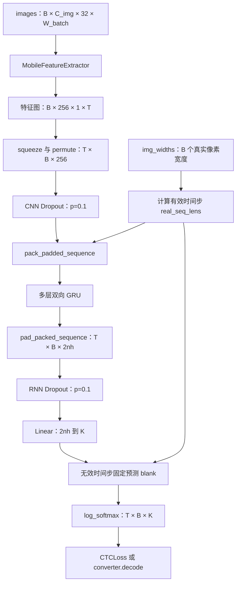
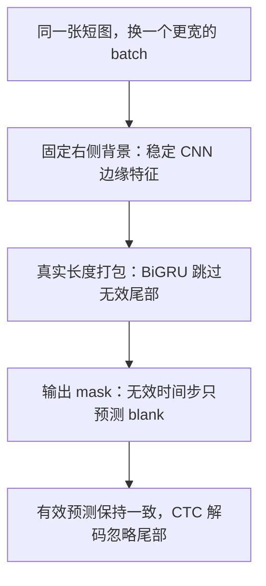

# model.py：从图片特征到 CTC 字符序列

本文帮助新手理解 CRNN 的数据流、张量形状和有效序列长度，以及 CNN、双向 GRU 与 CTC 分类头如何配合。

代码入口：[recognition/models/model.py](../../../../recognition/models/model.py)。`recognition/runtime/model.py` 由 `tools/sync_recognition_runtime.py` 生成。已于 2026-10-08 对照当前实现核对；修改相关实现时同步更新本页。

**`CRNN` 用 CNN 把图片变成从左到右的特征序列，用双向 GRU 理解上下文，再为每个时间步输出各字符类别的对数概率。** 最终字符串由 converter 解码，训练损失由训练脚本计算。

配套阅读：[dataset.py 导读](dataset-analysis.md)说明图片和真实宽度从哪里来，[converter.py 导读](converter-analysis.md)说明类别编号与 CTC 解码；整体约定见 [Recognition 架构](../../recognition.md)。

## 1. 输入输出：先把四种维度分清

```python
model = CRNN(img_height=32, nc=3, n_class=converter.num_classes)
log_probs = model(images, img_widths=img_widths)
texts = converter.decode(log_probs, layout="TBC")
```

| 符号 / 参数 | 含义 | 当前典型值 |
| --- | --- | --- |
| `B` | 同批图片数量 | 由 DataLoader 决定 |
| `C_img` / `nc` | 图像通道数 | 新模型使用 RGB，即 `3` |
| `W_batch` | 含右侧保护区与 batch padding 的图片宽度 | batch 内动态确定 |
| `T` | CNN 输出的总时间步数 | 当前共享 collate 下为 `W_batch / 4` |
| `K` / `n_class` | 字符类别数，含 blank 和 UNK | `converter.num_classes` |
| `nh` | GRU 每个方向的隐藏维度 | 默认 `256` |

输入图片为 `[B, C_img, 32, W_batch]`，`img_widths` 为 `[B]`；输出是 **`[T, B, K]`，即 TBC**，值为 `log_softmax` 后的对数概率。

图像通道数和字符类别数是不同的维度，本文分别用 `C_img`、`K` 表示，避免都缩写成 `C`。`T` 包括被屏蔽的无效尾部位置，未必等于任意一张图的有效长度。

## 2. 代码结构与整体流程

| 类 / 方法 | 职责 |
| --- | --- |
| `DepthwiseSeparableConv` | 深度卷积、逐点卷积、BatchNorm、ReLU6 的组合 |
| `MobileFeatureExtractor` | 将高度 32 的图片压成高度 1 的特征图 |
| `CRNN.__init__` | 连接 CNN、Dropout、多层 BiGRU（`num_layers`，默认 2）和分类头 |
| `_calc_cnn_output_width` | 从一个真实像素宽度算有效时间步 |
| `_calc_cnn_output_widths` | 同一公式的批量张量版本 |
| `CRNN.forward` | 图片到序列、长度打包、GRU、分类、blank mask、log_softmax |
| `_initialize_weights` | 按层类型初始化权重 |
| 文件末尾 `__main__` | 随机输入的 CPU 计时与形状展示 |



上图是主链路传入 `img_widths` 时的流程。省略该参数会走另一条兼容路径，详见第 6 节。

## 3. CNN：为什么图片会变成一个序列

### 3.1 深度可分离卷积做了什么

普通卷积同时处理空间位置和输入通道；这里拆成两步：

1. `depthwise`：`groups=in_ch`，每个输入通道分别做空间卷积，通道数不变。
2. `pointwise`：用 `1 × 1` 卷积组合各通道，调整到 `out_ch`。
3. 输出再经过 `BatchNorm2d` 和 `ReLU6`。

例如输入 32 通道、输出 64 通道，使用 `3 × 3` 卷积，仅比较卷积权重数量：

```text
标准卷积：       3 × 3 × 32 × 64 = 18,432
深度 + 逐点：    3 × 3 × 32 + 32 × 64 = 2,336
```

这个例子不含 BatchNorm 参数；实际推理耗时还受算子实现、硬件和输入尺寸影响。模块使用 MobileNet 风格的基本结构，并没有加载一个 torchvision 预训练 MobileNet。

### 3.2 用两张图走一遍真实形状

沿用 dataset 文档的例子：两张图真实宽度分别为 `64`、`100`，经共享 collate 得到 `[2, 3, 32, 136]`。

下表按当前代码逐层核对，其中每个 block 都包含两个深度可分离卷积：

| 阶段 | 关键设置 | 输出形状 |
| --- | --- | --- |
| 输入 | RGB；高度 `32`；batch 宽 `136` | `[2, 3, 32, 136]` |
| `stem` | 普通 `3 × 3` 卷积，stride `2`、padding `1`；BN + ReLU6 | `[2, 32, 16, 68]` |
| `pool` | `2 × 2` MaxPool，stride `2` | `[2, 32, 8, 34]` |
| `block1` | `32→64→64`；第一层 stride `(2, 1)`，第二层 stride `1` | `[2, 64, 4, 34]` |
| `block2` | `64→128→128`；同样只继续缩小高度 | `[2, 128, 2, 34]` |
| `block3` | `128→256→256`；同样只继续缩小高度 | `[2, 256, 1, 34]` |

高度逐步从 `32` 变成 `1`；宽度只在 `stem` 和 `pool` 缩小，后续保持不变。因此沿宽度的每一列，都成为一个含 256 个特征的时间步。

下采样对应 `self.stem`、`self.pool`、`self.block1～3`；修改结构时需同步更新宽度计算方法。

### 3.3 从特征图改成 GRU 接受的维度顺序

```text
[B, 256, 1, T]
    squeeze(2)       -> [B, 256, T]
    permute(2, 0, 1)  -> [T, B, 256]
```

`squeeze(2)` 只删除高度为 1 的那一维；`permute()` 交换维度含义，不会把图片或时间顺序打乱。这里不是把整张图片展平为一个超长向量，而是保留横向位置顺序。

构造函数要求 `img_height == 32`，forward 还会检查 CNN 输出高度为 `1`。新模型的 `nc=3` 由调用方传入；特征提取器自身的默认 `input_channel=1` 和文件末尾的单通道示例，不代表当前训练入口使用灰度。

## 4. 宽度怎样精确变成时间步

代码按实际卷积与池化的取整规则计算，不能对任意宽度直接用 `W // 4`：

```text
stem_width = (W + 2 × 1 - 3) // 2 + 1
time_steps = (stem_width - 2) // 2 + 1

对正常正整数宽度，等价于：(W + 1) // 4
```

| 像素宽度 `W` | `stem` 后宽度 | 有效时间步 |
| --- | --- | --- |
| `48` | `24` | `12` |
| `64` | `32` | `16` |
| `65` | `33` | `16` |
| `66` | `33` | `16` |
| `67` | `34` | `17` |
| `100` | `50` | `25` |
| `136` | `68` | `34` |

`67` 是一个方便的核对点：简单整除得到 `16`，当前 CNN 实际得到 `17`。调用代码应复用模型的长度方法，让后续结构修改有一个明确的同步位置。

在两张图的例子中：

```text
batch 画布宽度：       136       -> CNN 总时间步 T = 34
第一张真实宽度：       64        -> 有效时间步 16
第二张真实宽度：       100       -> 有效时间步 25
```

这两种长度分别决定输出张量的公共形状和每张图片真正参与 GRU / CTC 的部分。forward 会将有效长度限制到 `[1, T]`，但这个保护操作不能替代调用方正确传递与图片一一对应的宽度。

## 5. 三处配合，避免 padding 改变识别结果

这是本文件最需要结合 dataset 理解的设计。CNN、双向 GRU 和最终解码会在不同位置受到 padding 影响，所以需要分别处理。

### 5.1 CNN：每张图都需要固定的右侧背景

卷积会读取邻近像素。如果短图单独推理时内容贴着张量右边界，和它放进一个更宽的 batch 时看到的背景就可能不同，右侧有效特征也会变化。

当前 CNN 的横向感受野宽度为 `53` 像素：stem 后为 `3`，pool 后为 `5`，后面 6 个 `3 × 3` 深度卷积各增加 `8`，得到 `5 + 6 × 8 = 53`。dataset 因此为每张图保留至少 `32` 像素的右侧背景，让有效位置的感受野不碰到随 batch 变化的右边界。

保护区由 dataset 提供，模型不会在内部自动补上。若直接拼接输入而漏掉这一步，只传对 `img_widths` 仍不足以实现同样的边缘处理。

### 5.2 BiGRU：真正跳过每张图的无效尾部

GRU 有前向和反向两个方向。若让反向 GRU 从公共序列末尾开始，它会先经过 padding，再进入真实文字；即使 padding 特征全部置零，训练后的 GRU bias 也可能让隐藏状态在这些时间步继续变化。

这里通过 `PackedSequence` 只让每张图的有效前缀参与 GRU：

```text
CNN 的公共序列长度 T = 34

第一张：有效 16 步 | 无效 18 步
第二张：有效 25 步 | 无效  9 步

pack 后交给 GRU 的有效特征总数：16 + 25 = 41
pad 后重新得到公共形状：[34, 2, 512]  （nh=256）
```

`pack_padded_sequence()` 使用的长度通过 `.detach().cpu()` 移到 CPU，`enforce_sorted=False` 表示调用方无需先按长度降序排列。配套 `pad_packed_sequence(..., total_length=T)` 恢复公共时间维，并恢复原 batch 顺序，所以输出仍可对应原来的标签和路径。

长度打包只减少 GRU 对无效位置的处理，前面的 CNN 仍然处理整个补齐图像；这也是 dataset 桶采样仍有价值的原因。

### 5.3 分类输出：无效时间步必须成为 blank

解包后的无效特征通常是零，但经过带 bias 的 `Linear` 后仍可能偏向某个字符。因此代码在分类头之后再次覆盖无效位置的 logits：

```text
blank 类别 0： 0
其余类别：    -1e9
```

经过 log_softmax，这些位置的 argmax 固定为 blank。于是 converter 可以解码整个 `[T, B, K]` 输出，而不会把无效尾部当作文字。



这里的“一致”针对固定预处理、`model.eval()` 下的有效预测，并允许后端浮点误差。训练时仍有随机增强、Dropout 和依赖当前 batch 的 BatchNorm 统计，不能据此承诺训练模式下的逐值一致。

## 6. BiGRU、分类头和两种 forward 路径

当前启用的是**2 层双向 GRU**（`num_layers=2`）：输入特征为 `256` 维，每个方向隐藏维度默认 `nh=256`，因此输出是 `512` 维。前向看左侧上下文，反向看右侧上下文，两者拼接后交给分类头；层数必须与 checkpoint 一致，`infer_num_layers` 可按权重键推断。

| 阶段 | 默认维度变化 | 说明 |
| --- | --- | --- |
| CNN 后 Dropout | `[T, B, 256]` 不变 | `p=0.1` |
| 2 层 BiGRU | `256 → 2 × 256` | `batch_first=False`，层间 dropout 为 `0.15`（推理时不生效） |
| RNN 后 Dropout | `[T, B, 512]` 不变 | `p=0.1` |
| `embedding` | `512 → K` | 实际是 `nn.Linear` 分类头，不是词嵌入查表 |
| `log_softmax(dim=2)` | `[T, B, K]` 不变 | 沿类别维归一化，直接供 CTC 使用 |

`model.eval()` 会关闭两个 Dropout 并使用 BatchNorm 的运行统计；`torch.no_grad()` 负责关闭梯度记录，二者用途不同。

`forward()` 的可选参数影响实质行为：

| 调用 | GRU 处理范围 | 输出尾部 |
| --- | --- | --- |
| `model(images, img_widths=widths)` | 每张图自己的有效长度 | 无效时间步强制 blank |
| `model(images)` | 全部 `T` 个时间步 | 不执行上述长度 mask |

主训练、验证与推理链路应传递真实宽度；`img_widths=None` 的兼容接口无法表达各图片的有效边界。

## 7. 和 CTC Loss 怎样衔接

本文件没有创建 `CTCLoss`。在 [recognition/train.py](../../../../recognition/train.py) 中，四个输入一起送入损失函数：

| CTC 输入 | 来源 | 两图示例 |
| --- | --- | --- |
| `log_probs` | `model(images, img_widths=...)` | `[34, 2, K]` |
| `targets` | `converter.encode(labels)` | 展平的标签编号 |
| `input_lengths` | `model._calc_cnn_output_widths(img_widths)` | `[16, 25]` |
| `target_lengths` | `converter.encode(labels)` | 如“你好”“你 A”对应 `[2, 3]` |

CTC 允许一段图片时间序列对应较短的文字标签，因此不要求一个时间步严格对应一个字。但有效时间步必须足够容纳目标路径：

```text
最少有效时间步 = 标签编号数量 + 相邻相同目标编号的对数

"你好"：2 个字符、0 对相邻重复 -> 至少 2 步
"好好"：2 个字符、1 对相邻重复 -> 至少 3 步，可用 好 → blank → 好
"AAA" ：3 个字符、2 对相邻重复 -> 至少 5 步
```

相邻相同的字需要 blank 隔开，否则解码会合并。因此不存在适用于所有标签的固定“最多能识别 `T/2` 个字”规则；文件末尾打印的字符容量估算只能作粗略提示。

训练脚本使用 `CTCLoss(blank=0, zero_infinity=True)`。无法对齐而出现的无穷损失会被归零，这不能让过长标签凭空变得可学习。排查时应同时看缩放上限、真实时间步、标签长度和相邻重复情况。

## 8. 权重初始化与参数量

初始化时，CNN 卷积使用 Kaiming normal；BatchNorm 的缩放参数为 `1`、偏置为 `0`；GRU 输入权重用 Xavier uniform、循环权重用 orthogonal、偏置为 `0`；Linear 使用 Xavier uniform 和零偏置。加载 checkpoint 后，这些初始值会被已训练参数覆盖。

对当前代码实例化 `CRNN(img_height=32, nc=3, n_class=6000, nh=256)`，逐模块统计 `sum(p.numel() for p in module.parameters())` 得到：

| 部分 | 参数数 |
| --- | ---: |
| CNN | 137,792 |
| BiGRU | 789,504 |
| Linear | 3,078,000 |
| 合计 | 4,005,296 |

这里 `6000` 是演示用**总类别数**，不是对当前 `keys.txt` 大小的声明。参数量不包括 BatchNorm 的运行统计等 buffer。这个配置下分类头占据多数参数，类别数量会直接影响模型大小。

模型结构和参数量不能保证固定加速倍数。速度与准确率需使用配套权重和独立数据实测，操作见[运行说明](../running.md)；本页示例只核对形状、参数量和 CTC 契约。

## 9. 可运行的小例子：把三个文件接起来

在仓库根目录用 `.venv/bin/python` 运行。示例使用随机初始化模型和人工图片张量，只检查输入输出契约与 CTC 连接，不预设能识别出正确文字：

```python
from pathlib import Path
from tempfile import TemporaryDirectory

import torch

from recognition.components.converter import LabelConverter
from recognition.components.dataset import dynamic_padding_collate_fn
from recognition.models.model import CRNN

torch.manual_seed(7)
torch.set_num_threads(1)

with TemporaryDirectory() as temp_dir:
    keys_path = Path(temp_dir) / "keys.txt"
    keys_path.write_text("你\n好\nA\n \n", encoding="utf-8")
    converter = LabelConverter(str(keys_path))

    # 模拟经过归一化后的两张图片，0 表示归一化空间中的中灰。
    images, labels, img_widths = dynamic_padding_collate_fn([
        (torch.zeros(3, 32, 64), "你好"),
        (torch.zeros(3, 32, 100), "你 A"),
    ])
    model = CRNN(img_height=32, nc=3, n_class=converter.num_classes).eval()
    targets, target_lengths = converter.encode(list(labels))
    input_lengths = model._calc_cnn_output_widths(img_widths)

    with torch.no_grad():
        log_probs = model(images, img_widths=img_widths)
        loss = torch.nn.CTCLoss(blank=0, zero_infinity=True)(
            log_probs, targets, input_lengths, target_lengths
        )

    assert images.shape == (2, 3, 32, 136)
    assert input_lengths.tolist() == [16, 25]
    assert log_probs.shape == (34, 2, 6)
    assert torch.isfinite(loss).item()
    # 两张图各自有效区之后，所有时间步都必须预测 blank=0。
    assert (log_probs[16:, 0].argmax(dim=1) == 0).all().item()
    assert (log_probs[25:, 1].argmax(dim=1) == 0).all().item()

    print("输出形状：", tuple(log_probs.shape))
    print("有效长度：", input_lengths.tolist())
    print("示例 loss：", loss.item())
    print("随机模型解码：", converter.decode(log_probs, layout="TBC"))
```

## 10. 接手时如何定位问题

| 现象 / 改动 | 优先核对 |
| --- | --- |
| 输入通道报错 | dataset 的 `num_channels`、模型的 `nc` 和 checkpoint 首层通道是否一致 |
| CNN 输出高度断言失败 | 实际输入高度和 CNN 下采样结构 |
| batch=1 与混合宽度 batch 的短图结果不同 | 固定右侧背景、真实长度打包、输出 blank mask，以及是否 `eval()` |
| CTC loss 异常或长标签学不到 | 每张图的有效时间步、标签长度、重复字符、缩放上限 |
| 更换 `keys.txt` 后异常 | `n_class` 和字符编号顺序是否与 checkpoint 一致 |
| 修改横向卷积、stride 或 padding | 同步长度公式、CNN 右侧保护区与导出包装器，并验证批次一致性 |

导出时还需阅读 [recognition_export_onnx.py](../../../../recognition_export_onnx.py) 的 `OnnxExportWrapper`：它复用模型层，但有自己的 forward、宽度计算和 mask 逻辑。只改 `CRNN.forward()` 不会自动更新那段代码。

对应测试在 [test_recognition_batch_invariance.py](../../../../tests/test_recognition_batch_invariance.py)：覆盖 PyTorch 有效输出一致性、PackedSequence 反向传播、ONNX 的 GRU `sequence_lens`、ONNX 与 PyTorch 数值对齐，以及 OpenVINO 批次一致性。这里“反向传播”指梯度计算，与 BiGRU 的反向阅读方向是两件事。
