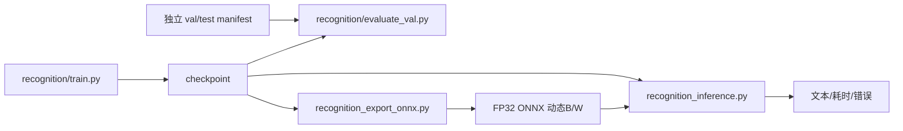

# Recognition 运行说明

本文指导识别模型的训练、续训、评估、导出、CPU 部署与量化，并说明各入口的默认配置和使用边界。

核对日期：2026-09-13。参数、默认值和处理边界以链接的当前实现为依据。

操作入口见 [包说明](../../../recognition/README.md)，输入与张量契约见[当前架构](../recognition.md)。
以下命令在仓库根目录执行，权重占位路径须替换为实际文件。




主入口：

- `../../../recognition/train.py`：训练与训练期验证；
- `../../../recognition/evaluate_val.py`：独立 manifest 的 Accuracy/CER/错误样本；
- `../../../recognition/inference.py`：PyTorch checkpoint 调试；
- `../../../recognition_export_onnx.py`：带 `img_widths`、动态 batch/width 的 ONNX；
- `../../../recognition_inference.py`：ONNX/OpenVINO/PyTorch 部署推理。
- `../../../recognition_benchmark_cpu.py`：带标注的 CPU CER、整行准确率、耗时和逐图预测报告；
- `../../../recognition_quantize_static.py`：共享预处理的 NNCF 静态量化，以及基于真实 CER 的精度恢复。

`train.py` 的 `TRAIN_ANNOTATION` 可配置一个标注路径或多个标注路径；当前训练集按配置顺序
合并 `train_annotation.txt` 与 synthesis1、synthesis2、synthesis3、red、lines、
confusable、degraded、edge 共八份合成标注，各文件内的图片路径分别相对于
自身所在目录解析。

### 训练与续训

`recognition/train.py` 保留训练、验证循环，并显式传入顶部配置。
`recognition/utils/training_run.py` 负责命令行参数、配置核对、运行目录、状态恢复和保存策略；
`recognition/utils/training_checkpoint.py` 负责检查点序列化、原子读写与字典兼容检查。

每个完整 epoch 在验证、学习率调度后原子保存 `last.pth`，从第一轮生效；
第 100 轮起另存每 5 轮备份与 CER 最低的 Top-3。三类文件均包含模型、AdamW、
ReduceLROnPlateau、已完成轮次、global_step、随机状态、字典与配置，均可用于续训。
推理和导出通过 `extract_state_dict` 读取其中的模型权重。周期备份不自动限制保留数量。

```bash
# 新训练；输出路径在启动时打印
.venv/bin/python recognition/train.py

# 从检查点下一轮继续，目标总轮数使用 train.py 中的 EPOCHS 常量
.venv/bin/python recognition/train.py \
  --resume recognition/checkpoints/<run>/last.pth

# 旧纯权重只能初始化新训练，必须提供该权重训练时使用的原始字典
.venv/bin/python recognition/train.py \
  --weights recognition/checkpoints/<old-model>.pth \
  --weights-keys /path/to/original/keys.txt
```

训练轮数、初始学习率、随机种子和日志根目录统一使用 `train.py` 的 `EPOCHS`、
`LEARNING_RATE`、`RANDOM_SEED`、`LOG_DIR` 常量，不再提供对应命令行参数。
`--resume` 恢复检查点的学习率、调度等待计数和随机状态；`--weights` 按当前常量
初始化优化器、调度器和轮次。两者均要求字典内容及顺序一致，不自动迁移输出层；删字符前的旧模型
不能直接用于删字符后的新字典。旧纯权重未保存优化器等状态，无法补成完整续训。

续训核对标注文件内容摘要、模型/数据加载/字符转换实现和关键配置，差异时报错。
源码校验取完整文件 SHA-256，包含注释和 docstring；仅修改被校验文件的注释也会使旧检查点的
`implementation` 摘要不匹配。继续原实验应使用保存检查点时的源码版本；需要在新版本
继续学习时使用 `--weights` 初始化新运行，不要直接修改检查点摘要绕过校验。
图片内容不逐张计算摘要，原地替换图片后应使用 `--weights` 启动新实验。
随机状态恢复覆盖 Python、NumPy、PyTorch 与 CUDA，续训从完整轮次边界开始；
中断轮次会重跑，不承诺跨硬件或依赖版本的逐位一致性。

每次启动（包括续训）默认在 `recognition/checkpoints/ocr_exp_<时间戳>/` 和
`recognition/runs/ocr_exp_<时间戳>/` 新建独立目录；可用 `--checkpoint-dir`
指定本次检查点空目录，日志目录在 `LOG_DIR` 下自动新建。TensorBoard 的轮次和步数继续递增。续训继承原 Top-K
排名，但只清理本次输出目录中的淘汰文件，保留原运行产物。完整检查点包含优化器，
磁盘占用高于旧纯权重文件。

示例：

```bash
.venv/bin/python recognition/train.py

# evaluate_val.py 当前仍使用文件顶部常量，不支持命令行参数。
# 先配置 MODEL_PATH、设置 VAL_ANNOTATION，并为本次评估设置 ERROR_OUTPUT_FILE。
.venv/bin/python recognition/evaluate_val.py

.venv/bin/python recognition_export_onnx.py \
  --model_path recognition/checkpoints/<model>.pth \
  --output_path artifacts/recognition/<version>/model.onnx \
  --keys_path recognition/keys.txt \
  --img_height 32 \
  --img_width 256

.venv/bin/python recognition_inference.py \
  --model_path artifacts/recognition/<version>/model.onnx \
  --backend auto \
  --keys_path recognition/keys.txt \
  --image_path recognition/data/test_images1 \
  --batch_size 32
```

### CPU 部署与静态量化

导出支持 `--output_type logits` 省略 LogSoftmax，仍返回 `[T,B,C]` 并将 padding
位置设为 blank。它适用于当前 greedy CTC 解码；需要概率、置信度或 CTC loss 时，
保留默认的 `log_probs`，或先对 logits 做 LogSoftmax。导出会校验动态 batch/width、
GRU 的 sequence_lens 和 PyTorch 数值一致性，并写入字典 SHA256；ONNX 推理会核对字典。
`--img_width` 仅是导出样例宽度，不限制实际文字框宽度。

ONNX 导出包装器直接生成带 `sequence_lens` 和动态 `initial_h` 的标准双向 GRU，
按 ONNX 门顺序转换权重，并设置 `linear_before_reset=1` 对齐 PyTorch 的 GRU 公式。
导出过程不再经过 `prim::PackPadded/PadPacked`，避免中间节点形状推断和通用 GRU
批次警告。此转换仅在 ONNX 导出时启用；训练、验证和普通 PyTorch 推理仍使用原有
`PackedSequence` 路径，模型参数、checkpoint 格式、CTC 长度和预处理契约均不变，
已有权重无需重新训练。当前专用映射支持单层、带 bias 的双向 GRU；其他配置明确报错。
仍使用 `dynamo=False` 导出器，其弃用提示与批次一致性无关，未作全局警告屏蔽。

独立的新版入口是 `../../../recognition_export_onnx_dynamo.py`，需要 PyTorch >= 2.9、
onnx、onnxscript 和 onnxruntime，默认生成 `best_recognition_dynamo.onnx`：

```bash
.venv/bin/python recognition_export_onnx_dynamo.py \
  --model_path recognition/checkpoints/<model>.pth \
  --output_path best_recognition_dynamo.onnx
```

新版固定使用 `dynamo=True`、opset 18 和 `dynamic_shapes`，不回退到 TorchScript。
通过官方 [torch.onnx.ops.symbolic](https://docs.pytorch.org/docs/2.9/onnx_ops.html)
生成标准 GRU、MaxPool 和输出形状转换，避免按样例的宽度奇偶性或 batch=1 特化；
运行端不需要自定义算子插件。导出约束范围为 batch 1～256、输入张量宽度 80～16384，
高度固定 32；`--img_width` 只选择范围内的样例宽度。沿用 `img_widths`、TBC 输出和
字典 SHA256 元数据，支持 `--output_type logits`，可直接使用现有 ONNX/OpenVINO 推理入口。
新版对源模型制作独立推理快照，不改变训练模式或参数，不需要重新训练。
文件通过图检查、原始 PyTorch 数值对照和跨 batch 检查后才写入目标路径；
使用新版自带图优化，不依赖 onnx-simplifier。当前环境可能打印 torchvision ROI 算子
注册的类型标注提示，这与本模型无关；旧导出器弃用提示不会由新版入口产生。

推理 `--backend auto` 按 `.pth/.onnx/.xml` 选择后端。`--num_threads` 默认为 1，
可在目标机器实测 1/2/4/6；不能把逻辑 CPU 总数当成最优线程数。
ONNX 默认关闭线程空转，避免等待下一张图时抢占预处理 CPU；`--allow_spinning`
只应在完整流水线实测获益时开启。非 PyTorch 后端的张量预处理/解码固定用一个
PyTorch 线程，推理线程由后端管理，避免线程池互相竞争。
OpenVINO 使用单 stream、LATENCY 和 FP32 浮点计算提示，INT8 层仍按量化图执行。
本机 OpenVINO 2026.0 CPU 的双向 GRU 在实测中仍遍历 padding，造成大量末字丢失。
`../../../recognition/utils/openvino.py` 在加载/量化前将其改为两个正向 GRU，并用
batch Gather 按各样本真实长度显式反转反向分支的输入、输出；最终沿用 blank mask。
这样保留完整 CNN 背景保护区，又使有效反向状态不受 padding 污染。该处理仅面向
当前不消费最终 hidden state、有效长度大于零的 CRNN；已修复 IR 再次加载时不重复改图。
回归测试同时要求 OpenVINO 跨 batch 一致和对齐 PyTorch，不能仅比较两个 OpenVINO 结果。
单图默认 `--num_workers 0` 避免创建进程开销；离线批处理可开启 `--sort_by_width`
减少无效 padding，输出恢复原文件排序。显示的后端耗时包含解码，总耗时还包含预处理。

```bash
.venv/bin/python recognition_benchmark_cpu.py \
  --model_path outputs/recognition/model.onnx \
  --annotation recognition/data/val_annotation.txt \
  --num_threads 4 --output outputs/recognition/evaluation.json

.venv/bin/python recognition_quantize_static.py \
  --onnx_model outputs/recognition/model.onnx \
  --calibration_dir recognition/data/train_images \
  --validation_annotation recognition/data/val_annotation.txt \
  --output_dir outputs/recognition/int8 --subset_size 300
```

量化从模型读取 RGB/灰度通道，复用 InferenceDataset 和 dynamic_padding_collate_fn，
包含透明合成、保守去章、`[-1,1]` 归一化、动态宽度及 32px 右侧保护区；禁止单独将校准
长图压到 256。排序后按固定种子抽取训练图片，保存校准名单。默认保留 GRU 和分类层
FP32；`--quantize_head` 是需另行评估的实验选项，不承诺必然提高速度或保持准确率。

`--accuracy_control --max_drop 0.001` 使用 NNCF 的 `1-CER` 指标恢复敏感层精度，
保存前再次要求 CER 增幅不超过 0.1 个百分点；必须提供真实文字标注，禁止用输出余弦
相似度替代 OCR 精度。精度控制集与校准集不能路径重叠，调参数据不能作为独立发布测试集。
`--validation_size 0`、评估脚本 `--limit 0` 表示全量；非零时按固定种子随机抽样。
未开启精度控制的量化只是生成候选模型，需要根据独立数据的 CER 与速度决定是否使用。
`--also_onnx` 可另生成 ONNX INT8，但不能与 OpenVINO 精度恢复同时启用。
该 ONNX 路径固定使用逐张量激活量化，避免 ORT CPU 的 QLinearConv 不支持逐通道
激活零点；保存后实际执行若干不同宽度输入，验证运行时兼容性。

历史报告中指定 epoch 120 权重的全量准确率、CPU 性能、OpenVINO 修复与部署命令见
[CPU 测试报告（2026-09-09）](../history/experiments/recognition-cpu-report-2026-09-09.md)。

初次准备数据的划分与标注核对见[数据工具](data-tools.md)。已有人工维护的数据不能直接重新划分。


## 当前默认配置与评估边界

训练高度 32、宽度上限 1800、RGB、batch 64、最多 680 轮、初始学习率 `3e-4`、
数据加载子进程 4 个。训练集为 train 加八份合成标注；默认字符统计只覆盖其中 synthesis1/2，
不等于完整训练统计。训练使用 AdamW、梯度裁剪 2、ReduceLROnPlateau；从第 1 轮验证。

`evaluate_val.py` 默认读取 val、batch 64、4 个加载子进程。它不限制图片宽度；
训练期验证经 `TextRecognitionDataset` 限宽 1800，超宽图片可能产生差异。
独立评估按 stem 映射标签，当前没有重复 stem 防护；空数据会在准确率计算时除零。
错误报告只在有错误时写入，零错误运行不会清理上次报告。检查方法见[待办](../../code-doc-todolist.md)。

包内 PyTorch 推理和评估按权重形状加载字典类别，不能识别“类别数相同但字典顺序不同”。
使用与权重配套的原字典；不要把 `load_state_dict` 成功当作字典内容校验。
