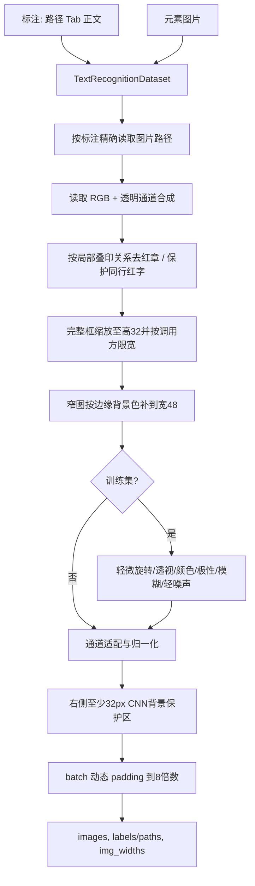
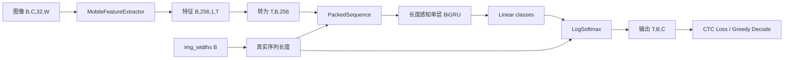

# Recognition 架构

本文说明识别系统当前的预处理、模型、字符解码与多后端数据契约，作为实现核对的架构入口。

## 职责

Recognition 接收 detection 输出的单个文字框，输出 Unicode 文本。支持彩色/深浅背景、PNG 和动态宽度处理。

当前基线为 MobileNet 风格 CNN + 单层双向 GRU + CTC head，输入高度固定为 32，宽度通常按比例缩放并在 batch 内动态 padding；超过调用方宽度上限时会横向压缩。
操作见[包入口](../../recognition/README.md)、[运行说明](guides/running.md)和[数据工具](guides/data-tools.md)，术语见[术语表](../terminology.md)。

## 数据与预处理

相关实现：

- `../../recognition/components/dataset.py`：图片路径校验、PNG 透明通道处理、缩放、增强、桶采样和动态 padding；
- `../../recognition/utils/checkpoint.py`：checkpoint 解包以及旧灰度/新 RGB 模型通道识别；
- `../../recognition/components/converter.py`：字典编码和显式 TBC/BTC 的 CTC greedy decode。

训练、验证、PyTorch 推理和多后端推理复用同一套不裁剪基础预处理。训练可额外使用随机增强；验证和测试禁止随机增强。

### 标点与下划线标注规范

2026-09-10 的数据整理记录采用中文分号 `；` 和中文逗号 `，`，
该次字典移除英文 `;`、`,`，其余字符保持原相对顺序。填空线和文字装饰下划线不标为 `_`；
文件名、邮箱、引物名等正文中的 `_` 仍保留，字典也保留此字符。
下划线须按图片语义校对，不能在加载器或解码后全局删除。
这是标注和模型字典的版本变更，不是在推理输出后统一替换字符；旧权重需使用原字典，
新字典必须配合重新训练、导出和验证。重生成方式见
[`recognition/datadoc/synthesis.md`](../../recognition/datadoc/synthesis.md)。

### 保守去红章与训练增强

`remove_red_seal` 在透明背景合成之后、缩放和随机增强之前统一执行，输入为 RGB。
现在按**局部红色与正文的交错叠印关系**判断，支持紧框内的断章、章字、星形和局部弧线，
不再要求每个连通区域都能拟合成完整圆章，也不要求正文墨迹比章墨迹多。

- 颜色候选：R ≥150、R 比 G/B 至少高25、G/B 色差不超过40；红色总面积不超过35%。
  纸面至少40%、边缘至少50%为近中性浅色，允许灰纸、轻微偏色及扫描颗粒。
- 正文证据：灰黑像素的 RGB 最大值不超过170、通道色差不超过35，且明确排除红色候选，
  防止红字被同时计为“黑字”。正文至少16像素，且不少于红像素数量的15%。
- 局部判定：相距不超过两倍正文行高的红色列分组；按正文列密度检查组内黑字支持率，
  同时要求红色既进入正文行、又有至少8%越过上边或下边。只剩半个章也可通过。
- 逐区域保护：分组通过后仍检查每个红色连通区域的黑字支持；完全位于正文行内的小红字
  保留。只有一个连通区域时，额外检查弧线、椭圆或复杂章形，避免简单边框和折线误触发。

最终只将通过检查的原始红像素替换为纸面中位色，不进行掩码膨胀、闭运算或内容裁剪。
纯红字、普通同行黑红混排、红底白字及无正文支持的红色内容保留；同组出现一个章也不会
清空整组红色。与正文完全对齐的章字、极暗的印泥和缺乏正文证据的片段仍可能残留。
红色标记/合法红字若与黑字交错且越过正文行，也存在误判可能；不透明印泥覆盖的正文无法
由此恢复。这些阈值属于启发式规则，上线效果仍需用红章及合法红字分组评估。
已有权重的验证/推理输入也会受这一确定性预处理影响。

历史样本核对见[2026-09-08 记录](history/experiments/red-seal-audit-2026-09-08.md)，不代表当前独立评估精度。

训练随机增强在等比缩放后执行，先做轻微旋转和透视，再应用其他增强（验证/推理不启用）：

| 类型 | 概率 | 覆盖场景 |
| --- | --- | --- |
| RandomRotation | 100% | 随机旋转 ±2°，按当前图片估计的背景色填充 |
| RandomPerspective | 30% | 轻微拍摄视角变化，distortion_scale=0.1，按当前图片估计的背景色填充 |
| ColorJitter | 70% | 曝光变化、扫描反差、彩字浓淡、轻微白平衡偏色 |
| RandomAutocontrast | 20% | 扫描软件拉伸灰度、截图对比度差异 |
| RandomInvert | 8% | 深色主题、黑底白字；残留红章也会随之反色 |
| GaussianBlur | 15% | 轻微失焦、低分辨率截图、缩放造成的模糊 |
| AddGaussianNoise | 15% | 扫描颗粒、相机传感器轻噪声 |
| RandomErasing | 5% | 污点、磨损、局部遮挡；面积 0.5%～3%，仍可能遮挡小数点或短文本关键笔画 |

灰度转换用于兼容旧单通道模型，ToTensor 和 Normalize 用于统一张量及数值范围，
均不是随机增强。完整 detection 框继续等比缩放与动态 padding，不做二次内容裁剪。
`RandomBackgroundGeometry` 复用 `_border_fill_color`，在几何扰动前取图片四周边缘的
逐通道中位数，供旋转和透视共同填充，兼容白底、深色底和彩色底。边缘被文字大量占据
或背景存在渐变时，这个单色估计仍可能与局部背景有差异。
训练旋转使用默认固定画布（expand=False），紧贴边缘的文字仍可能在旋转后超出画布。

## 标注与宽度边界

加载器只按首个 Tab 拆分路径与文字，文字再 `strip()`；不去外层引号、不做标点替换或 Unicode 归一化。
空文字被跳过并计数；坏格式与缺图在初始化时报告。PNG 是项目数据约定，
`resolve_image_path` 本身只检查文件存在，不强制后缀、不拒绝绝对路径。
透明图先按可见亮度选择黑/白背景合成，不能保证每种混合透明前景都保留全部细节。
Pillow 全局允许截断图片加载；采样器预扫描失败暂记宽高比 1，实际加载失败仍报具体路径。

训练按原图宽高比排序组 batch，再打乱 batch 顺序；不是先完成增强再分桶。
缩放宽度为 `round(原宽 × 32 / 原高)`，训练和训练期验证上限是 `IMG_WIDTH=1800`，
超过上限直接横向压缩至上限。窄图居中补背景到 48 像素，补后的宽度计入 `img_widths`。
包内独立评估和推理默认不设宽度上限，见[运行边界](guides/running.md#当前默认配置与评估边界)。

## 模型与张量契约

稳定契约：

- 输入图像：`float32 [B, C, 32, W]`，归一化到以 0.5 为 mean/std 的空间；
- `img_widths`：`int32/int64 [B]`，表示不含右侧背景保护区和 batch padding 的真实图片宽度；
- 输出：`float32 [T, B, num_classes]`，简称 TBC；
- 类别：0=`blank`，1=`UNK`，2 起来自 `keys.txt`；
- `keys.txt` 的内容和顺序是模型 ABI，变更字典必须训练/导出新模型版本；
- CNN 宽度下采样约为 4 倍，CTC 长度必须依据每张图片真实宽度计算。

`LabelConverter.decode` 已要求显式 `layout="TBC"` 或 `"BTC"`。部署入口会用已知 batch size 和类别数把后端输出规范为 TBC，不再用维度大小关系猜测。

每张图片右侧固定增加 32 px 背景保护区，隔离 CNN 感受野与动态 batch 边界；BiGRU 使用 `PackedSequence`，正反向都只处理各图片的有效时间步。自动测试要求同一图片在 batch=1 和混合宽度 batch 中的有效输出一致，并验证 ONNX GRU 带有 `sequence_lens` 输入。

CNN 有效时间步精确为 `floor((W + 1) / 4)`，不能直接用浮点 `W/4` 代替。
默认 CNN 特征为 256 维，单层 BiGRU 每方向隐藏维度 256，分类头输入 512 维。
`forward` 可不传 `img_widths`，但此时不会跳过补边或强制 padding 为 blank；实际流水线必须传宽度。
CTC 可对齐条件为时间步至少等于标签字符数加相邻重复字符对数，不是固定“每字两步”。

`LabelConverter` 保留字典中的普通空格，未知字符编码为 1，解码输出 `[UNK]`。
解码只取 argmax、合并连续重复并去 blank，不另算 Softmax，也不去空格或引号。
训练和评估比较文本时另做首尾空白清理。字典重复行/多字符行的严格校验由数据工具提供，
当前 Converter 本身未完整校验，需在训练前核对字典。

## 验证与历史

跨 batch 一致性在 eval 模式验证，不能把含 Dropout 和随机增强的训练输出逐位比较。
单元测试覆盖共享预处理、CTC 长度及多后端输出；真实红章、白字、小字、长文本精度仍需独立数据验证。
未确定的训练收益、历史报告缺失和实现差距见[待办](../code-doc-todolist.md)。
[尾部实验记录](history/experiments/tail-experiments-history.md)、`history/model/`、`history/batch/`、日期分析及 `model_resnet50.py` 属于历史资料，不代表当前模型。
